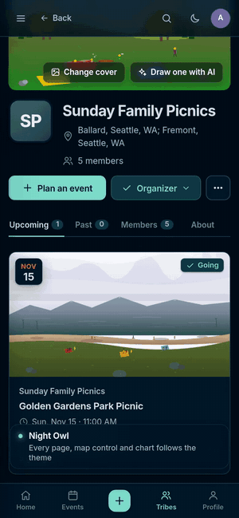
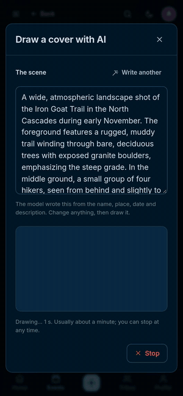
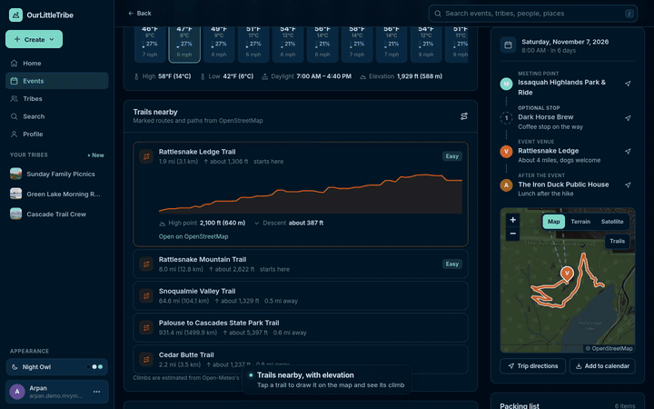

<p align="center"></p>

<h1 align="center">OurLittleTribe</h1>

<p align="center">Plan hikes, picnics, runs and book clubs with your people.<br>
Say the plan in your own words; a model on your own hardware does the rest.</p>

<p align="center">
  
  
  
  
  
  
  <br>
  
  
  
  
</p>

## See it in action

| Say the plan, get the event | AI cover art, drawn live | Trails with their climb |
|:---:|:---:|:---:|
|  |  |  |

Full walkthroughs, about three minutes each, in the Night Owl theme:
**[phone](docs/demo/ourlittletribe-phone.mp4)** and **[desktop](docs/demo/ourlittletribe-desktop.mp4)**.
The parts where the model is working are sped up and marked on screen.

---

OurLittleTribe is a free, self-hosted alternative to Meetup. A tribe plans an
outing; the app then helps the group get ready for it:

- **Say the plan, get the event.** *"Next Sunday 7am, meet at Green Lake park
  and ride, hike the Iron Goat Trail, lunch somewhere after"* becomes a title,
  date, time, tribe and every place on the map. "Lunch somewhere" becomes a
  real restaurant in the nearest town. The description is written *after* the
  places are found, from facts the app looked up (the real address, the drive
  time, the trail's grade and its OpenStreetMap record), so the model does not
  have to guess them.
- **Cover art drawn by the model.** It writes a scene for the tribe or outing,
  you change anything, and it draws it as SVG while you watch. Stop at any
  time and the model stops too.
- **Trails nearby, with their climb.** Marked routes and named paths around
  the venue, each with its length and climb; choosing one draws it on the map
  and shows its elevation profile.
- **Sixteen themes,** from Evergreen to Night Owl, Tokyo Night and Catppuccin;
  light, dark, or following the device.
- **The model drafts the prep list.** It reads the organiser's description,
  the forecast and elevation at the meeting point (Open-Meteo), the drive
  (OSRM), the daylight and the group size, and returns items with the fact
  each one answers to: *"Headlamp: sunset 16:42, group stays for photos"*.
  Answers are JSON constrained by a schema and checked again in Rust.
- **Search for what you need.** "My feet get cold" becomes wool socks, toe
  warmers and gaiters, and the map shows stores on *your* route that sell them,
  ranked by the minutes they add (OSRM duration table, not straight lines).
- **Everyone sees who has what.** Personal items show "5 of 8 have it" with
  faces; shared items show who is bringing them and whether they bought them.
- **Learned, not hand-written, pairings.** "Groups often also got…" comes from
  what earlier groups marked as bought (support, confidence, lift), and stays
  hidden until there are at least 10 trips of evidence.
- **Search that understands places.** Typing shows OpenStreetMap matches at
  once (Photon, falling back to Nominatim when Photon is down). The model then
  reads the search the way a person means it: "mt rainier henry jackson" is the
  Jackson Visitor Center at Paradise, and "snoqualmie falls parking" is the
  falls' actual car park, found by its OpenStreetMap tag beside the falls.
  The model picks only from real places found, so nothing it suggests appears
  unless the map has it.
- **More than one place.** An event has a meeting point and, optionally, stops
  on the way, optional stops and a venue, each placed by search or on one
  shared map. The event page shows the itinerary, and directions go through
  every stop.
- **Maps throughout.** Use your location, or click and drag a pin; a clicked
  point is named from the nearest address. The Events page shows every
  upcoming outing on a map beside the list.
- **Descriptions with formatting.** Event and tribe descriptions are written
  in a Markdown editor with a toolbar, a preview, starting outlines, and
  pictures by button, paste or drop. Rendering builds DOM nodes directly, so
  written text can never become markup.
- **Pictures.** Events, tribes and profiles have cover pictures, people have
  profile pictures, and anyone going can share photos from an outing. Every upload is turned upright, resized, and re-encoded as a
  plain JPEG, which removes EXIF data including GPS position.

There are no ads, no merchant accounts and no tracking. A starting point is
shared per event, only by choice, and deleted a day after the event.

## Layout

| Path | What it is |
|---|---|
| `crates/tribe-core` | Pure logic: route geometry, store ranking, basket analysis, local time formatting |
| `crates/tribe-db` | SQLite storage: users, sessions, tribes, events, prep items and marks, cached stores |
| `crates/tribe-places` | Clients for Open-Meteo, OSRM, Overpass, Photon and Nominatim (OpenStreetMap) |
| `crates/tribe-media` | Uploaded pictures: checked, turned upright, resized, re-encoded, stored on disk |
| `crates/tribe-brain` | The model client: trip facts in, checked items out; one request at a time |
| `crates/tribe-server` | The `ourlittletribe` binary: axum API, Argon2id accounts, the embedded web app |
| `web/` | The app: strict TypeScript in `web/src`, compiled to `web/dist` by the server's build script. Leaflet and the Inter font are vendored |
| `deploy/` | systemd unit, deploy script, and the voltforge.tech forwarding page |
| `docs/demo/` | The demo videos and the previews shown above |

The whole app is one 9.4 MB binary with the web files compiled in. Uploaded
pictures are the only files kept outside the database.

## Run it

```bash
(cd web && npm ci)    # once: the TypeScript compiler
cargo build --release   # compiles web/src, then embeds web/ in the binary
OLT_LLM_URL=http://127.0.0.1:8081/v1 target/release/ourlittletribe
# open http://127.0.0.1:8090 ; the first account becomes the admin
```

| Variable | Default | Meaning |
|---|---|---|
| `OLT_ADDR` | `127.0.0.1:8090` | where to listen |
| `OLT_DB` | `ourlittletribe.db` | SQLite file |
| `OLT_MEDIA` | `media` next to the database | folder for uploaded pictures |
| `OLT_LLM_URL` | unset | OpenAI-style base URL ending in `/v1`; unset turns planning and search off |
| `OLT_LLM_MODEL` | first listed | model id |
| `OLT_LLM_KEY` | unset | bearer key, if the model server needs one |
| `OLT_INSECURE_COOKIE` | unset | set to `1` to drop the cookie's `Secure` flag for plain-HTTP testing |

Any server with `/v1/chat/completions` and JSON-schema output works. On the
Jetson AGX Thor it is TensorRT Edge-LLM serving Qwen3.6-35B-A3B (NVFP4).

## Tests

```bash
cargo test --workspace                                      # 126 tests, no network
cargo test -p tribe-places --test live -- --ignored         # real map and weather services
OLT_LLM_URL=http://127.0.0.1:8081/v1 \
  cargo test -p tribe-brain --test live -- --ignored --nocapture   # the real model
```

## Deploy on the Thor

The app runs as a user service on `127.0.0.1:8090`. A second Tailscale node
named `ourlittletribe` runs beside it (unprivileged, userspace networking) and
publishes it with Funnel, so it has its own stable address:
**https://ourlittletribe.taildb9a39.ts.net**. The Thor's own node and the
Tigress Cub are untouched.

```bash
deploy/deploy.sh    # build, copy, restart; prints the two one-time commands below
ssh thor 'tailscale --socket=$XDG_RUNTIME_DIR/ourlittletribe-tailscaled.sock up --hostname=ourlittletribe'
ssh thor 'tailscale --socket=$XDG_RUNTIME_DIR/ourlittletribe-tailscaled.sock funnel --bg http://127.0.0.1:8090'
```

`deploy/ourlittletribe.html` is a forwarding page: copied into the
`arpanpathak/voltforge.tech` repository, it makes
`https://voltforge.tech/ourlittletribe` open the app. The design of all of this
is in the [book](book/src/ch10-going-live.md); what comes next is in the
[roadmap](ROADMAP.md).

## Measured on 2026-10-31

| Step | Result |
|---|---|
| Model plan for the Skyline Trail hike (Qwen3.6-35B NVFP4 on Thor) | 6–8 items in 4.6–7.5 s |
| Route Seattle → Paradise (OSRM) | 169 min, 167 km |
| Stores along that route (Overpass, 1.5 km corridor) | 68 found; first lookup 17 s, then cached for 30 min |
| Search "my feet get cold" | 5 items; top store Whittaker Mountaineering, Ashford, 0 min detour |

## Limits

- The public OSRM, Overpass, Photon and Nominatim servers are shared,
  rate-limited services. Photon blocks addresses that send bursts; while it
  does, place search uses Nominatim at one request a second, so the model's
  best matches take about ten seconds instead of two or three. Overpass in particular is often busy: the app tries a mirror, then
  falls back to stores it has already seen and says so on the page. A busy
  instance should run its own (the URLs live in `tribe_places::Endpoints`).
- Store results only know a shop's *type* from OpenStreetMap, not its stock.
- Sign-in is email and password; there is no email verification or password reset yet.
- The earlier Go/React prototype is in the git history before this rewrite (commit f5a405c).

## License

MIT. Map data © OpenStreetMap contributors.
