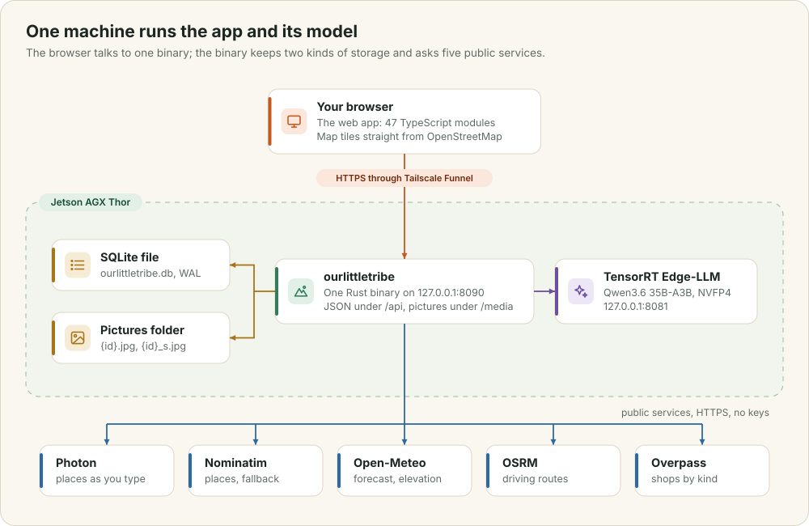
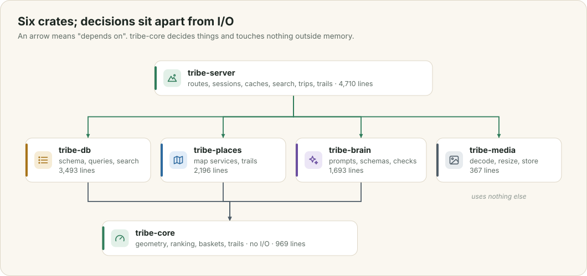
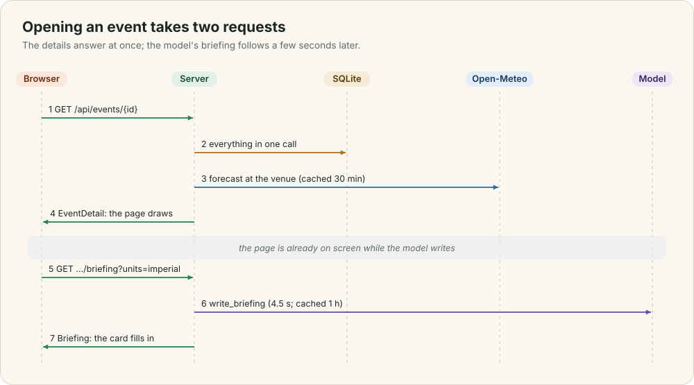

# High-level design

OurLittleTribe runs on one machine, an NVIDIA Jetson AGX Thor. One Rust program answers every request, keeps its data in one SQLite file and one folder of pictures, and asks a language model that runs on the same board. Everything else it needs, such as maps, forecasts and routes, comes from free public services. This chapter shows how those parts fit together, follows one request through them, and explains why the system has so few parts.

This chapter covers

- the parts of the system, and where each one runs
- the six Rust crates, and the rule that divides them
- what happens when you open an event
- the decisions behind one binary, one file and a local model

## 1.1 The parts

<figure>

<figcaption><b>Figure 1.1</b> The whole system. Green is the app, purple the model, gold storage, blue the services it calls.</figcaption>
</figure>

When you open the app, your browser loads the web app from the same server that answers its API calls. That server is one binary, `ourlittletribe`, listening on `127.0.0.1:8090`. It serves three things: the web app's files, a JSON API under `/api`, and uploaded pictures under `/media`.

The binary reaches the outside world in two directions. Inwards, it reads and writes `ourlittletribe.db`, a SQLite file, and a folder of pictures next to it. It also sends questions to TensorRT Edge-LLM, which serves the Qwen3.6 model on `127.0.0.1:8081` on the same board. Outwards, it calls five public services over HTTPS: Photon and Nominatim to find places, Open-Meteo for forecasts and elevation, OSRM for driving routes, and Overpass for shops. None of them needs an account or a key.

The only part that runs elsewhere is the map you see. Your browser loads map tiles straight from OpenStreetMap, so the server never handles them.

You reach the server through Tailscale Funnel, which gives it a public HTTPS address without opening a port on the router. Chapter 10 explains how.

## 1.2 The crates

<figure>

<figcaption><b>Figure 1.2</b> The six crates. An arrow means "depends on". Line counts are from the commit this book describes.</figcaption>
</figure>

The Rust code is split into six crates, and one rule decides where code goes: code that makes a decision lives apart from code that talks to the outside world.

`tribe-core` holds the decisions: route geometry, local time, store ranking, and the statistics behind "groups often also got". It has no I/O at all, so you test it by passing in plain values and checking what comes back. Each crate around it owns one kind of I/O. `tribe-db` owns the schema and every query, and takes a `&Connection`, so each test runs against a fresh in-memory database. `tribe-places` owns the five public services; its unit tests parse saved answers, and the tests that call the real services sit in `tests/live.rs`, run only when you ask for them with `--ignored`. `tribe-brain` owns the prompts, the JSON schemas and the checks on the model's answers. `tribe-media` owns decoding and resizing pictures.

`tribe-server` joins them: the HTTP routes, sessions, caches, the place search that combines services with the model, and trip planning. It is the only crate that knows all the others exist.

## 1.3 Opening an event

<figure>

<figcaption><b>Figure 1.3</b> The two requests behind one event page.</figcaption>
</figure>

When Ada opens her Skyline Trail event, the page sends `GET /api/events/{id}`. The server first reads the session cookie and finds who she is (chapter 9). It then runs one closure on the database thread that loads the event, its stops, the people going, the packing list with everyone's marks, the photos, and Ada's own starting point if she shared one. One closure means one trip to the database thread, however many tables it reads.

The server adds the conditions at the venue, from a 30-minute cache or from Open-Meteo, and answers with one JSON document, `EventDetail`. The page draws at once.

The model's briefing on those conditions takes about four and a half seconds to write, so it is not part of that answer. Once the page is on screen it asks separately, with `GET /api/events/{id}/briefing?units=imperial`, and the Conditions card fills in when the answer arrives. The second person to open the page that hour gets the briefing from the cache instantly.

## 1.4 Decisions

**One binary.** The server's build script compiles the web app and lists every file the page loads, and `include_bytes!` puts them inside the binary (chapter 8). Deploying means copying one file and restarting one service. The web app can never be a different version from the API it calls.

**One SQLite file.** A group app writes rarely: an RSVP, a ticked item, a new event. SQLite in write-ahead-log mode handles that with no database server to run, and the whole database backs up as one file. Every query runs on Tokio's blocking pool through one function, `Db::call`, which keeps `rusqlite`'s synchronous API out of the async code.

**A model on the same board.** The model reads people's plans, their descriptions and where they set off from. Running it on the Thor means none of that leaves the house, there is no bill per token, and it keeps working when a cloud service does not. The cost is that it answers one request at a time (chapter 4).

**Smart features come from the model or from data.** The packing list, the briefing, the drafts, the covers and the place guesses come from the model. "Groups often also got" comes from what groups actually bought. No table written by hand decides what a hike needs.
