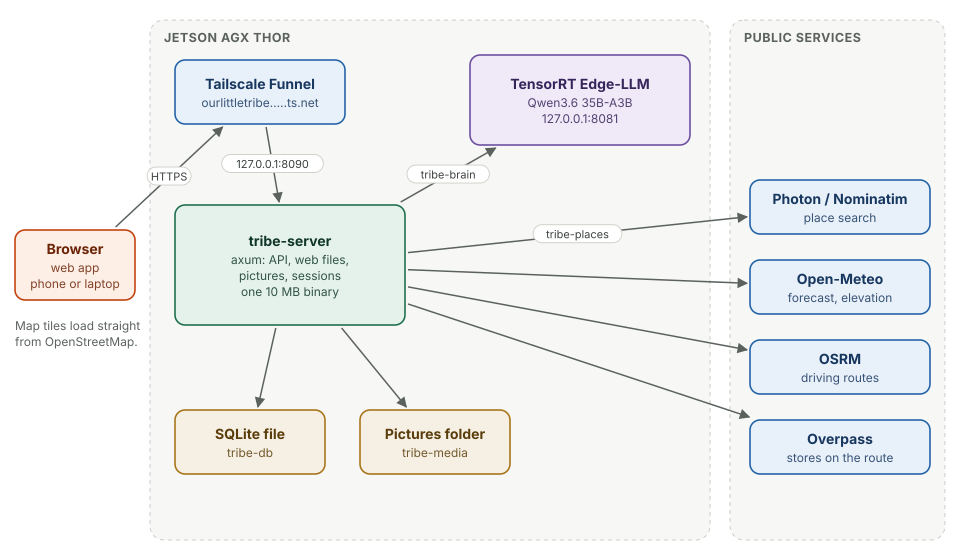
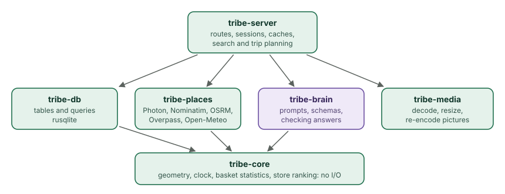

# High-level design

This chapter covers

- The parts of the system and how a request moves through them
- The six Rust crates and what each one owns
- The design decisions behind one binary, one file and a local model

## 1.1 The system

<figure>

<figcaption><b>Figure 1.1</b> The whole system. Green: this app. Purple: the model. Blue: services it calls. Brown: storage.</figcaption>
</figure>

A browser loads the web app from the same server that answers its API calls.
Everything runs on one NVIDIA Jetson AGX Thor:

- **`ourlittletribe`**, the server, listens on `127.0.0.1:8090`. It serves the
  web files, the JSON API under `/api`, and uploaded pictures under `/media`.
- **TensorRT Edge-LLM** serves Qwen3.6 on `127.0.0.1:8081` with an
  OpenAI-style API. The server is its only client from this app.
- **Tailscale Funnel** gives the server a public HTTPS address without
  opening a port on the router (chapter 10).

The server calls five free public services: Photon and Nominatim to find
places, Open-Meteo for forecasts and elevation, OSRM for driving routes, and
Overpass for shops. None needs a key. Map tiles load in the browser straight
from OpenStreetMap.

## 1.2 Crates

<figure>

<figcaption><b>Figure 1.2</b> The crates and their dependencies.</figcaption>
</figure>

| Crate | Owns | Lines |
|---|---|---|
| `tribe-core` | geometry, local time, basket statistics, store ranking; no I/O | 673 |
| `tribe-db` | the schema and every query | 2,588 |
| `tribe-places` | clients for the five map and weather services | 1,446 |
| `tribe-brain` | prompts, JSON schemas, and checking the model's answers | 1,065 |
| `tribe-media` | decoding, resizing and storing pictures | 339 |
| `tribe-server` | routes, sessions, caches, place search, trip planning | 3,753 |

The rule that shapes the split: code that decides things lives apart from
code that talks to the world. `tribe-core` has no I/O, so ranking a store or
counting how often two items were bought together is tested with plain
values. `tribe-db` takes a `&Connection`, so every query is tested against an
in-memory database. `tribe-places` and `tribe-brain` parse saved answers in
their unit tests and keep live calls in `tests/live.rs`, run with
`--ignored`.

## 1.3 A request, end to end

Opening an event page sends `GET /api/events/{id}`. The server:

1. reads the session cookie and finds the person (`auth::CurrentUser`);
2. runs one closure on the database thread that loads the event, its stops,
   attendees, the list with everyone's marks, the photos and the person's
   starting point;
3. adds the conditions at the venue, from a 30-minute cache or from
   Open-Meteo;
4. answers with one JSON document, `EventDetail`.

The page then asks for the model's briefing separately
(`GET /api/events/{id}/briefing`), so the page draws at once and the briefing
arrives a few seconds later.

## 1.4 Decisions

**One binary.** The web files are compiled into the server with
`include_bytes!`. Deploying is copying one file and restarting one service,
and the web app can never be a different version from the API.

**One SQLite file.** A group app writes rarely: an RSVP, a checked item, a new
event. SQLite in WAL mode handles that with no server to run, and the whole
database backs up as one file. All queries run on Tokio's blocking pool through one
`Db::call`, which keeps `rusqlite`'s synchronous API out of async code.

**A local model.** The model reads people's plans, descriptions and where
they start from. Running it on the same machine means none of that leaves
the house, there is no per-token bill, and it works when a cloud API does
not. The price is that one request runs at a time (chapter 4).

**No frontend framework.** The web app is plain ES modules, about 5,000
lines, with no build step (chapter 8). What the browser runs is what is in
the repository.

**Every smart feature uses the model or learned data.** The packing list,
the briefing, the drafts and the place guesses come from the model; "groups
often also got" comes from what groups actually bought. There are no
hand-written keyword tables deciding what a hike needs.
