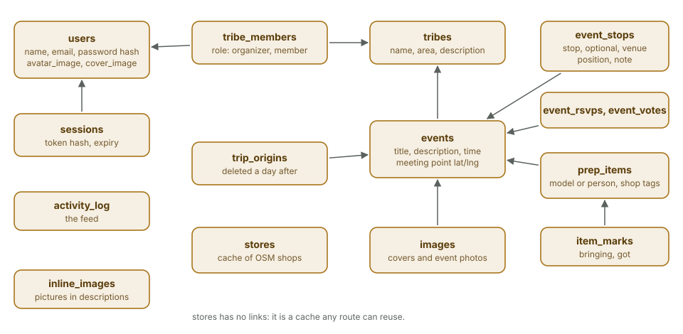

# The data

<div class="covers" markdown="1">

This chapter covers

- The tables, and what refers to what
- How the schema changes without a migration tool
- What is deleted, and when

</div>

## 2.1 Tables

<figure>

<figcaption><b>Figure 2.1</b> The tables. An arrow points from a row to the row it belongs to.</figcaption>
</figure>

Ids are random UUID strings and times are Unix seconds. Every reference
carries `ON DELETE CASCADE` or `ON DELETE SET NULL`, with foreign keys turned
on for each connection, so deleting an event removes its stops, list, marks,
photos and starting points in one statement.

| Table | One row is | Notes |
|---|---|---|
| `users` | a person | email unique ignoring case; Argon2id password hash; profile picture and banner ids |
| `sessions` | a signed-in browser | only the SHA-256 of the token is stored |
| `tribes`, `tribe_members` | a group, and who is in it | role is `organizer` or `member` |
| `events` | an outing | the meeting point is on the event itself: name, latitude, longitude |
| `event_stops` | another place on the plan | kind `stop`, `optional` or `venue`, kept in the planner's order |
| `event_rsvps`, `event_votes` | going or not; a thumbs up or down | |
| `prep_items` | a thing to bring | `personal` (one each) or `shared` (one for the group); `model` or `person` added it; the OpenStreetMap shop kinds that sell it |
| `item_marks` | one person's mark on an item | `bringing` or `got` |
| `trip_origins` | where one person starts from | shared by choice, for store search |
| `stores` | a shop seen in OpenStreetMap | a cache shared by every route |
| `images` | an event cover, event photo or tribe cover | the file itself is on disk |
| `inline_images` | a picture placed in a description | |
| `activity_log` | one line of the feed | |

## 2.2 Two decisions in the schema

**The meeting point is part of the event; the other places are rows.** Every
event has exactly one meeting point, and most have nothing else, so the
common case is one row with no join. `event_stops` holds the rest in order.
The itinerary the page shows is always: the meeting point, then the stops in
order, then the venue, which the editor keeps last.

**A "cover" is the newest image row of its kind.** Setting a cover inserts a
row and, in the same transaction, deletes the previous cover's row and
returns its id so the server can delete the files. There is no `cover_id`
column to keep in step with the images table.

## 2.3 Changing the schema

`schema::prepare` runs on every start. It creates any missing table with
`CREATE TABLE IF NOT EXISTS`, then checks a short list of columns added since
the first release:

```rust
const ADDED_COLUMNS: [(&str, &str, &str); 2] = [
    ("users", "avatar_image", "TEXT"),
    ("users", "cover_image", "TEXT"),
];
```

For each one it asks `pragma_table_info` whether the column exists and runs
`ALTER TABLE … ADD COLUMN` if not. An old database file is brought up to date
by starting the new binary; nothing else is needed. This only handles added
tables and nullable columns. A rename or a changed constraint would need a
real migration step, which the app has not needed yet.

## 2.4 What is deleted, and when

An hourly task, `maintenance::purge`, deletes:

| What | When |
|---|---|
| Starting points | a day after their event |
| Expired sessions | at expiry, 30 days after sign-in |
| Shops in the `stores` cache | 90 days after they were last seen |
| Events, with everything attached | a year after they happened |

The same task then sweeps the pictures folder: any file whose id is no longer
in `images`, `inline_images` or a person's profile columns is deleted
(chapter 7).

## 2.5 Learned pairings

"Groups often also got" is computed from `item_marks`, not written by hand.
Each finished list where people marked items as got is one basket. For an
item A and another item B, `tribe-core::basket` computes:

- **support**: the share of baskets that hold both;
- **confidence**: the share of baskets with A that also hold B;
- **lift**: confidence divided by B's share of all baskets. Above 1, B shows up
  with A more often than chance.

A pair is shown only with at least 10 baskets in total, 3 baskets holding
both, and a lift of at least 1.1. Until then the app shows nothing, rather
than a pattern from three trips. The same pairings are also given to the
model as facts when it plans a list (chapter 4).
