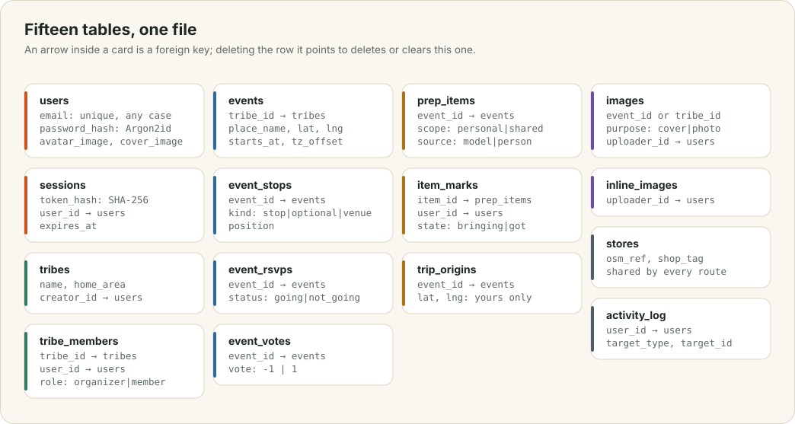
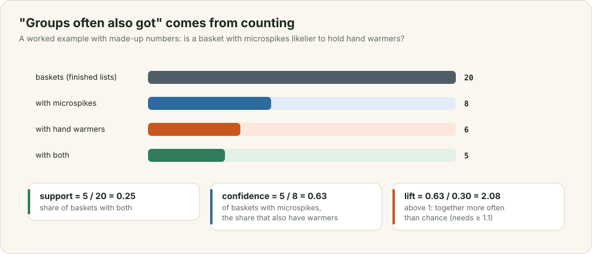

# The data

Everything the app knows lives in one SQLite file: people, tribes, events, lists, marks, and a record of every picture. This chapter shows the tables, follows Ada's event into them, and explains how the schema changes between versions without a migration tool, what is deleted and when, and how a few counts become the "groups often also got" suggestions.

<div class="covers" markdown="1">

This chapter covers

- the fifteen tables, and what refers to what
- how one event is stored, from meeting point to ticked items
- adding columns to an existing database on start
- what is deleted, and when
- support, confidence and lift, the counts behind learned pairings
- the search index: stemmed words, and three-letter pieces for typos

</div>

## 2.1 The tables

<figure>

<figcaption><b>Figure 2.1</b> The tables. An arrow inside a card is a foreign key.</figcaption>
</figure>

Every id is a random UUID stored as text, and every time is a count of Unix seconds. Every foreign key carries `ON DELETE CASCADE` or `ON DELETE SET NULL`, and each connection turns foreign keys on, so deleting a row deletes or clears everything that refers to it. When Ada deletes an event, one `DELETE` removes its stops, RSVPs, votes, list, marks, photos and starting points.

## 2.2 One event, stored

When Ada saves the Skyline Trail event, the server writes one row to `events`. The meeting point is part of that row, as `place_name`, `lat` and `lng`, because every event has exactly one meeting point and most have nothing else. Reading the common event then needs no join.

If she adds a coffee stop and the trail as the venue, each becomes a row in `event_stops` with a `kind` (`stop`, `optional` or `venue`) and a `position` that keeps her order. The page always shows the meeting point first, then the stops in order, then the venue.

When Bo presses "I'm going", the server writes a row to `event_rsvps`. When the model plans the list, each item becomes a row in `prep_items` with `source = 'model'`; items people add get `source = 'person'`. An item's `scope` says whether everyone brings their own (`personal`) or one person brings it for the group (`shared`). When Bo ticks "microspikes", the server writes his row to `item_marks` with `state = 'got'`. Each person has at most one mark per item, because the pair `(item_id, user_id)` is the primary key.

A picture is a row in `images` plus two files on disk (chapter 7). The row says what the picture belongs to: an event's cover, an event photo, or a tribe's cover. A cover is simply the newest image of that kind. Setting a new cover inserts its row and, in the same transaction, deletes the old cover's row and returns its id, so the server can delete the old files. There is no `cover_id` column to keep in step.

## 2.3 Changing the schema

`schema::prepare` runs every time the server starts. It turns on foreign keys and write-ahead logging, creates any missing table with `CREATE TABLE IF NOT EXISTS`, and then checks a short list of columns added since the first release:

```rust
const ADDED_COLUMNS: [(&str, &str, &str); 2] = [
    ("users", "avatar_image", "TEXT"),
    ("users", "cover_image", "TEXT"),
];
```

For each one, it asks `pragma_table_info` whether the column exists, and runs `ALTER TABLE … ADD COLUMN` if it does not. You upgrade an old database by starting the new binary. This handles new tables and new nullable columns only. Renaming a column or changing a constraint would need a real migration step, which the app has not needed yet.

## 2.4 What is deleted, and when

Once an hour, `maintenance::purge` deletes:

- each person's starting point, a day after the event;
- expired sessions, 30 days after sign-in;
- shops in the `stores` cache that no search has seen for 90 days;
- events, with everything attached, a year after they happened.

The same task then sweeps the pictures folder and deletes every file whose id no row mentions any more (chapter 7). A replaced cover or a deleted photo leaves nothing behind on disk.

## 2.5 Learned pairings

<figure>

<figcaption><b>Figure 2.2</b> Support, confidence and lift for one pair of items, with made-up numbers.</figcaption>
</figure>

When you look at an item on a list, the app may say "groups who bought this also got hand warmers". Nobody wrote that rule. `tribe-core::basket` counts it from `item_marks`. Each finished list where people marked items as got is one **basket**. For an item A and another item B, it computes three numbers:

- **support** is the share of all baskets that hold both A and B;
- **confidence** is the share of baskets with A that also hold B;
- **lift** is confidence divided by B's share of all baskets. A lift above 1 means B turns up with A more often than it would by chance.

In figure 2.2, 8 of 20 baskets have microspikes, 6 have hand warmers, and 5 have both. Of the baskets with microspikes, 5 of 8, or 0.63, also have hand warmers, while hand warmers appear in 6 of 20 baskets overall, or 0.30. The lift is 0.63 / 0.30 = 2.08: a group that buys microspikes is about twice as likely as an average group to buy hand warmers.

The app shows a pair only when there are at least 10 baskets in total, at least 3 of them hold both items, and the lift is at least 1.1. Below those thresholds a "pattern" is three trips that happened to look alike, so the app shows nothing. The same pairings are given to the model as facts when it plans a list (chapter 4).

## 2.6 The search index

Someone in Ada's tribe started a tribe called "ai-won't-replace-us". Searching for "ai replacing" has to find it, even though neither the phrase nor the word "replacing" appears in the name. A `LIKE '%ai replacing%'` query finds nothing, and the first version of search used exactly that. `tribe-db` now keeps two SQLite FTS5 tables beside the data, in `search_index.rs`.

`search_words` splits every tribe's, event's and person's text into words, and stems each word with the Porter stemmer. "replacing", "replaced" and "replace" all become `replac`, and the punctuation in "ai-won't-replace-us" splits it into the words `ai`, `won`, `t`, `replac` and `us`. A search becomes a query that matches any of its words as a prefix, `"ai"* OR "replacing"*`, and SQLite's `bm25` ranks the rows that match more words, and match in the name rather than the description, first. Words of one letter, such as the `t` of "won't", are left out of the query, because as a prefix they match nearly everything.

`search_grams` indexes every three-letter piece of each name instead of its words, which is how a typo still matches. "snoqualme" shares most of its pieces with "Snoqualmie". The server asks this table for rows sharing any piece with a word of the search, and then keeps only rows with a word that shares at least half of the search word's pieces. Each word is padded with spaces before it is cut, so its first and last letters form pieces of their own, and a typo in the middle of a word leaves most of them intact: "javkson" shares 5 of its 8 padded pieces with "jackson".

Triggers on `tribes`, `events` and `users` keep both tables in step with every insert, update and delete, and `schema::prepare` refills them on start, so a database written before the index existed is searchable at once. A renamed tribe is found by its new name and no longer by its old one; a test checks exactly that.

The search page also asks the model for related words (chapter 4). The same index answers those words, and the results appear under "Related".
