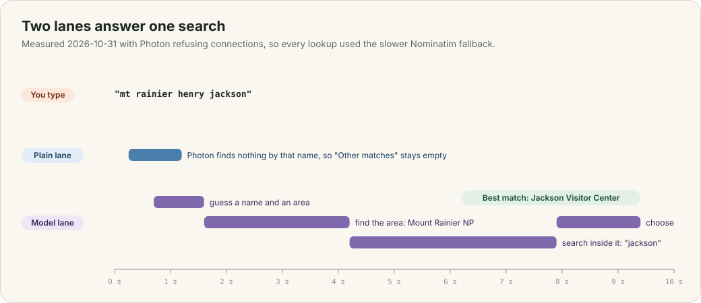
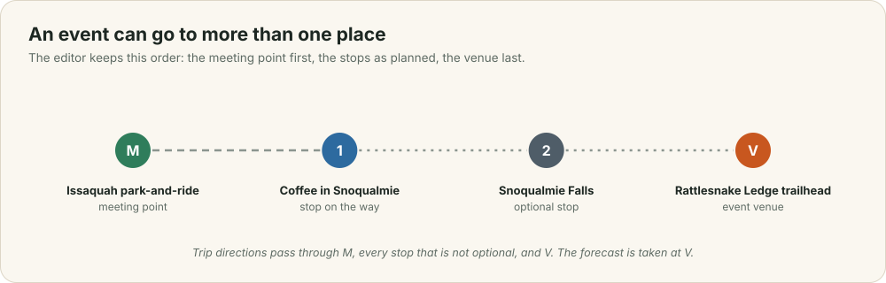

# Places and search

Ada types "mt rainier henry jackson" into the meeting-point box. She means the Jackson Visitor Center at Paradise, but no map service finds anything for those words. This chapter explains why, and how the search box answers in two lanes: instant results from OpenStreetMap, and a few seconds later the place the model works out she meant. It ends with how an event holds more than one place.

This chapter covers

- why a geocoder cannot find a place from the way people describe it
- the two lanes of the search box, and what each one costs
- searching inside an area the model names
- what the server does when a public geocoder refuses it
- events with a meeting point, stops and a venue

## 3.1 Why plain search fails

A **geocoder** turns text into places by matching the words against the names in its index. Photon, the search-as-you-type geocoder built on OpenStreetMap, needs every word you type to appear in a place's name or address. In OpenStreetMap the place Ada means is called "Jackson Visitor Center". "mt rainier" describes where it is, so it is not part of the name, and "henry" appears nowhere: the building is named after Henry M. Jackson, but OpenStreetMap does not say so. Photon finds nothing. If Ada types "jackson visitor center", it finds the place at once.

People describe places the first way. They give the area and a name they half remember, they abbreviate ("mt"), and they misspell. The search box has to cope with all of that.

## 3.2 Two lanes

<figure>

<figcaption><b>Figure 3.1</b> One search, measured on 2026-10-31.</figcaption>
</figure>

The search box, `components/place_search.ts`, sends two requests for the same text.

The **plain lane** waits until you stop typing for 250 ms, then sends `GET /api/places`. The server passes the text to the geocoder as it is, and the results appear under "Other matches". For a name you know exactly, this is all you need, and it answers in well under a second.

The **model lane** waits for a longer pause, 700 ms, then sends `GET /api/places/best-matches`. Waiting longer means the model is not asked about every half-typed word. The server, in `place_search.rs`, then works in four steps:

1. **Read the search.** `Brain::interpret_place_search` gets the text and the region you are in, such as "Seattle, Washington, United States", found by a reverse lookup of your position and cached for each tenth of a degree. The model answers with up to three guesses, each a name and an area: `{"name": "Henry Jackson Trail", "area": "Mount Rainier National Park, Washington"}`. The name is wrong, but the area is right, and the next steps only need the area to be right.
2. **Find the area.** The server searches for the area's name among towns, parks, peaks and boundaries. The area's outline, padded by 15%, becomes the bounds for the next step. An area with no outline, such as a summit, gets a box 0.2° in each direction. Areas are cached for a day.
3. **Search inside it.** The server searches the bounds for the full guessed name first. The model's name is often longer or more official than the map's, and a geocoder needs every word to match, so the server then searches the bounds for each distinctive word of four letters or more, up to three of them, the words you typed first. "jackson" inside Mount Rainier National Park returns the Jackson Visitor Center.
4. **Choose.** The places found, together with the plain lane's results, go back to the model as a numbered list. `Brain::choose_places` answers with the numbers of the places you meant, best first. It can only pick from the list, so it cannot invent a place.

The server tries the guesses one after another, most likely first. It stops once it has six candidates, and gives up on the lookups after 12 seconds. The answer is cached for half an hour for that text and your rough position, so a second search for the same thing is instant.

| Search | Best match | Time |
|---|---|---|
| mt rainier henry jackson | Jackson Visitor Center, Paradise | 9.4 s |
| ballard locks | Hiram M. Chittenden Locks | 8.8 s |
| snoqualmie falls lodge | Salish Lodge & Spa | 5.5 s |
| paradise inn rainier | Paradise Inn | 7.6 s |

These times were measured on 2026-10-31, while Photon was refusing connections from the Thor's network, so every lookup used the slower fallback in the next section.

## 3.3 When a geocoder refuses

The public Photon server limits how often one address may call it. While this chapter was being tested, it refused every connection from the Thor for hours. Every Photon call in `tribe-places` therefore falls back to **Nominatim**, OpenStreetMap's own geocoder, when it fails.

Nominatim's usage policy allows one request a second, so its calls pass through a lock that spaces them 1.1 seconds apart. After Photon fails once, the server skips it for two minutes, so later searches go straight to Nominatim instead of waiting for Photon's 6-second timeout every time. Photon calls are also limited to three at a time.

The fallback is correct but slow, which is why the table above shows 5 to 10 seconds. The lasting fix is a place index on the Thor itself (chapter 11).

## 3.4 More than one place

<figure>

<figcaption><b>Figure 3.2</b> An itinerary. The optional stop's line is dotted.</figcaption>
</figure>

An event has a **meeting point**, where everyone gathers first. It may also have **stops on the way** that everyone makes, **optional stops** for whoever wants them, and one **venue** where the event itself happens. The places editor, `components/locations_editor.ts`, shows each as a row with its own search box, and one map shows them all as pins labelled M, 1, 2 and so on, and V, joined by a dashed line in order. You can select a row and click the map to place it, or drag a pin; the server then names the point from the nearest address.

The event page lists the same itinerary. "Trip directions" opens Google Maps with the meeting point, every stop that is not optional, and the venue as waypoints. The forecast and the elevation are taken at the venue when there is one, because the weather that matters for a hike is at the trail, not in the car park where people meet (chapter 5).
