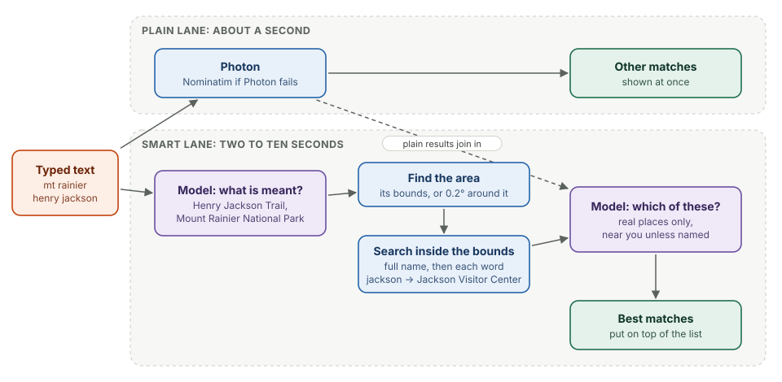

# Places and search

This chapter covers

- Why plain geocoding fails on the way people type places
- The two-lane place search: instant results, then the model's best matches
- Falling back when a public geocoder refuses
- Events with more than one place

## 3.1 The problem

A **geocoder** turns text into places by matching words against names. Photon,
the search-as-you-type geocoder the app uses first, finds nothing for
"mt rainier henry jackson". The place the person means is called
"Jackson Visitor Center" in OpenStreetMap; "mt rainier" is where it is, not part
of its name, and "henry" appears nowhere. Searching "henry jackson visitor
center" finds it at once. People type the first way.

Two other limits showed up in testing. Photon does not expand "mt" to "mount".
And the public Photon server blocks addresses that send bursts of requests:
while testing this chapter, it refused every connection from the Thor's
network.

## 3.2 Two lanes

<figure>

<figcaption><b>Figure 3.1</b> Place search. The browser asks both lanes; the plain lane's results show first.</figcaption>
</figure>

The search box (`components/place_search.js`) sends two requests:

- **`GET /api/places`** after 250 ms without typing: the text goes to the
  geocoder as it is, and the results appear under "Other matches".
- **`GET /api/places/smart`** after a 700 ms pause: the model's lane. Its
  results appear on top under "Best matches". Waiting for a longer pause keeps
  the model and the geocoder from being asked about every half-typed word.

The smart lane, in `tribe-server/src/place_search.rs`:

1. **Read the search.** `Brain::interpret_place_search` gets the text and the
   region the person is in ("Seattle, Washington, United States", from a
   reverse lookup cached per tenth of a degree). It answers with up to three
   guesses, each a name and an area:
   `{"name": "Henry Jackson Trail", "area": "Mount Rainier National Park, Washington"}`.
2. **Find the area.** The area name is searched with Photon's place-kind
   filters (towns, parks, peaks, boundaries). Its outline, padded by 15%,
   becomes the search bounds; a place with no outline, such as a summit, gets
   a box 0.2° each way. Areas are cached for a day.
3. **Search inside the bounds.** First the full name. A geocoder needs every
   word to match, so a longer official name than the map has finds nothing;
   then each distinctive word is searched alone inside the bounds, the words
   the person typed first. "jackson" inside Mount Rainier National Park returns
   Jackson Visitor Center.
4. **Choose.** The places found, plus the plain lane's results, go back to the
   model as a numbered list. `Brain::choose_places` answers with the numbers
   of the places the person meant, best first, preferring places near them.
   Only places from the list can be returned, so the model cannot invent one.

Guesses are looked up one after another, most likely first, and the lane stops
once it has six candidates or after 12 seconds. Results are cached for half
an hour per search and rough position.

| Search | Best match | Time |
|---|---|---|
| mt rainier henry jackson | Jackson Visitor Center, Paradise | 9.4 s |
| ballard locks | Hiram M. Chittenden Locks | 8.8 s |
| snoqualmie falls lodge | Salish Lodge & Spa | 5.5 s |
| paradise inn rainier | Paradise Inn | 7.6 s |

These were measured on 2026-10-31 while Photon was refusing connections, so
every lookup went through the slower fallback below.

## 3.3 When a geocoder refuses

Every Photon call in `tribe-places` falls back to **Nominatim**, OpenStreetMap's
own geocoder, on any failure. Nominatim's usage policy allows one request a
second, so its calls pass through a lock that spaces them 1.1 s apart. After a
Photon failure, Photon is skipped for two minutes instead of being retried on
every call. Photon calls are also limited to three at a time.

The fallback is slower but correct; it is why the timings in the table above
are 5 to 10 seconds. The lasting fix is the app's own place index (chapter 11).

## 3.4 More than one place

An event has a **meeting point** and, optionally, **stops on the way** that
everyone makes, **optional stops** for whoever wants them, and one **venue**
where the event itself happens. The editor (`components/locations_editor.js`)
shows each as a row with its own search box, and one map shows them all as
pins labelled M, 1, 2… and V, joined by a dashed line in order. Selecting a
row and clicking the map places that row; dragging a pin moves it, and the
point is named from the nearest address.

The event page lists the same itinerary. "Trip directions" opens Google Maps
with the meeting point, every stop that is not optional, and the venue as
waypoints. The forecast and elevation are taken at the venue when there is
one (chapter 5), because a hike's weather is at the trail, not at the
park-and-ride where people meet.
