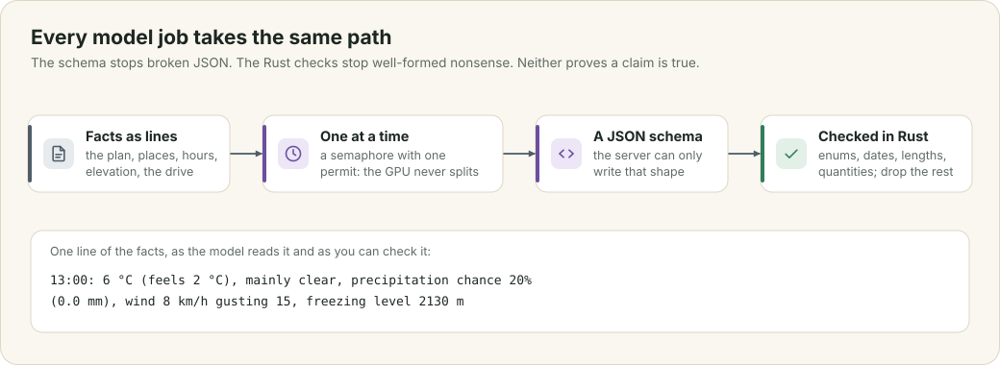
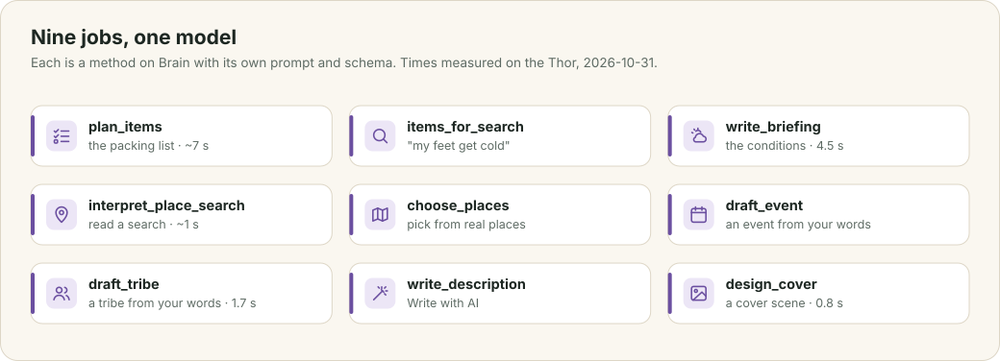

# The model

Ten features of the app ask a language model a question: the packing list, the conditions briefing, the place search, the drafts, Write with AI, the covers, and the related words that widen a search. They share one path through the code, and that path decides how far you can trust each answer. This chapter describes the model and where it runs, follows one question along that path, and then takes the ten jobs in turn.

This chapter covers

- the model the app runs, and how fast it answers
- the one path every question follows: facts, a queue, a schema and checks
- the ten jobs, and what each one gets and gives back
- how prompts are written
- what the app does when the model is wrong or missing

## 4.1 The model and its server

The app uses **Qwen3.6 35B-A3B**, quantised to NVFP4 and served by **TensorRT Edge-LLM** on the same Jetson AGX Thor, at `127.0.0.1:8081`. It is a mixture-of-experts model: of its 35 billion parameters, about 3 billion take part in producing each token, which is why it answers short questions in about a second on the Thor.

The server speaks the OpenAI chat-completions format, so `tribe-brain` works unchanged against any server that does. You point the app at it with `OLT_LLM_URL`; if you do not name a model, the client asks `/v1/models` once and uses the first one listed.

## 4.2 One path

<figure>

<figcaption><b>Figure 4.1</b> The path every question takes, and one line of the facts the model reads.</figcaption>
</figure>

Every job goes through one method, `Brain::ask`, in four steps.

**Facts as lines.** The question is plain text that the model can read and that you can check by eye: the plan, the places in order, the forecast hour by hour, the elevation, the drive. `TripFacts::describe` writes it, and the packing list and the briefing read the same text. When an answer looks wrong, you read the facts it was given and see at once whether the fault was in the facts or in the model.

**One at a time.** A semaphore with a single permit wraps every call. If Ada and Bo both ask for something at once, the second request waits for the first, instead of both slowing down while they share the GPU. The request turns the model's thinking mode off, because these are short answers to precise questions.

**A JSON schema.** Each request carries `response_format` with a strict JSON schema for that job. The model server constrains generation to that shape, so the answer always parses. Enumerations in the schema, such as the briefing's verdict `great`, `good`, `mixed` or `poor`, keep a field to known values.

**Checks in Rust.** The parsed answer is checked again: enum values, dates as `YYYY-MM-DD`, times as `HH:MM`, text clipped to a length, quantities clamped to between 1 and 500, at most one venue, shop tags reduced to plain lower-case words. Anything that fails is dropped. The code does not try to repair it by guessing.

The schema stops malformed JSON, and the Rust checks stop well-formed nonsense. Neither one can tell whether a claim is true. That is why each job below is designed so that a wrong answer is visible and cheap to correct.

## 4.3 The jobs

<figure>

<figcaption><b>Figure 4.2</b> The ten jobs, each a method on <code>Brain</code>.</figcaption>
</figure>

**The packing list**, `plan_items`. The model gets the trip facts, what is already on the list, and the learned pairings from chapter 2. It answers with items, of which the server keeps at most 14. Each item has a `why` that must name the fact it answers to, with its number: "Freezing level 1,900 m, below the trail", not "good for hiking". Each also carries the OpenStreetMap shop kinds that sell it, which chapter 6 uses to find stores. Items are added with `source = model`, and anyone can delete them.

**Searching the list**, `items_for_search`. Bo types "my feet get cold". The model reads the same trip facts and suggests up to five items, such as wool socks and toe warmers, each with its reason.

**The briefing**, `write_briefing`. Chapter 5.

**Place search**, `interpret_place_search` and `choose_places`. Chapter 3.

**An event from your own words**, `draft_event`. Ada types or says "next Saturday let's hike Rattlesnake Ledge, meet at the Issaquah park and ride at 8, coffee in Snoqualmie on the way". The model gets her words, today's date and weekday, and the region she is in, and fills in the title, a Markdown description, the date, the time, the meeting point and the other places, each as a name and an area. The server then looks every place up as the place search does, all at once, and returns real coordinates where it found them and the search text where it did not. Said on Saturday 31 October 2026, "next Saturday" became 2026-11-07. The form is filled in, not saved: the fields that changed flash so Ada can check them.

**A tribe from your own words**, `draft_tribe`. "We are parents in Fremont who take the kids on easy Saturday morning hikes twice a month" becomes a name ("Fremont Family Hikes"), a home area ("Fremont") and a description, in 1.7 seconds.

**Write with AI**, `write_description`. The description editor's menu sends the form's details as lines, the current text, and an instruction: write it, improve it, shorten it, add a schedule, add what to bring, or anything you type or say. The answer replaces the text in a way the browser's undo can reverse.

**A cover**, `design_cover`. Chapter 7.

**Related words**, `related_words`. Someone searching for "hiking" probably also means "hike", "trail" and "trek". The model lists up to eight such words, the server drops any already in the search, and the search index from chapter 2 answers them. The page shows those results under "Related", after the direct matches, which never wait for the model.

## 4.4 Prompts

The instructions live in `tribe-brain/src/prompt.rs`, one constant for each job. They follow the same rules as this book: say what to do, name the facts to use, and give limits as numbers. Two instructions appear in several of them. The first forbids inventing facts and says what to do instead: when there is no forecast yet, the briefing says the forecast arrives about 16 days ahead and describes what is typical for the place and the season. The second sets units: the briefing is told which units the reader uses, and to give every temperature in both °F and °C.

## 4.5 When the model is wrong or missing

If you start the server without `OLT_LLM_URL`, every model feature is turned off. Those routes answer `503 Service Unavailable`, the event page hides its model features (the `model_ready` field of `EventDetail` is false), and the assistants show the error. Everything else works.

When the model is wrong, the design keeps the person in charge. A drafted form is filled in but not saved. List items say why they are there, so a wrong one is easy to spot and delete. Place search only offers real places. The briefing is the weakest point: in one test it stated a freezing level of 7,600 ft where the forecast it was given said 6,989 ft. Checking every number in a briefing against its facts is on the roadmap (chapter 11).
