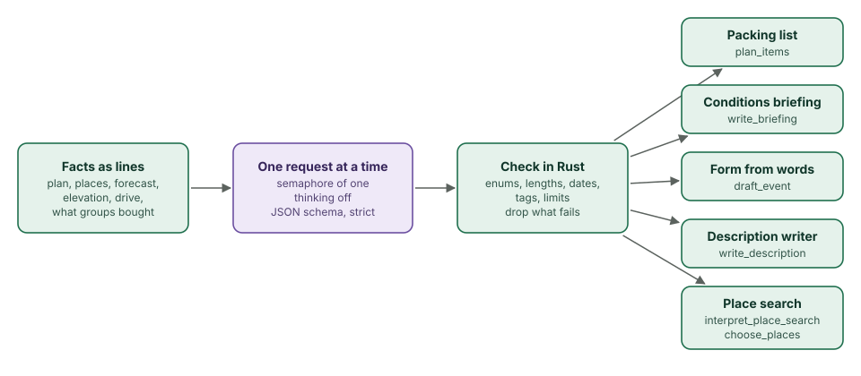

# The model

This chapter covers

- The model the app runs, and where
- The one path every model request follows
- Each job the model does: lists, briefings, drafts, writing, place search
- What the app does when the model is wrong or missing

## 4.1 The model and the server

The app uses **Qwen3.6 35B-A3B**, quantized to NVFP4, served by **TensorRT
Edge-LLM** on the same Jetson AGX Thor at `127.0.0.1:8081`. The server speaks
the OpenAI chat-completions format, so `tribe-brain` would work unchanged
against any server that does: `OLT_LLM_URL` sets the address, and the model
name is read from `/v1/models` when it is not configured.

A mixture-of-experts model with 3 billion active parameters per token answers
short structured questions in about a second on the Thor. Measured on
2026-10-31: reading a place search, 0.7 to 1.1 s; a conditions briefing,
4.5 s; a packing list of seven items, about 7 s.

## 4.2 One path for every job

<figure>

<figcaption><b>Figure 4.1</b> The path every model request takes, and the five jobs that use it.</figcaption>
</figure>

Every job goes through `Brain::ask_json`:

1. **Facts as lines.** The question is plain text the model can read and a
   person can check: the plan, the itinerary, the forecast hour by hour, the
   elevation, the drive. `TripFacts::describe` writes it, and the same text
   feeds the packing list and the briefing.
2. **One request at a time.** A semaphore with one permit wraps every call,
   so two people planning at once queue instead of splitting the GPU.
   Thinking is turned off (`enable_thinking: false`); these are short answers.
3. **A JSON schema.** The request carries `response_format` with a strict
   schema, so the server constrains generation to valid JSON of that shape.
   Enumerations in the schema (`great`, `good`, `mixed`, `poor`) keep fields
   to known values.
4. **Check in Rust.** The answer is parsed with serde and then checked again:
   enum values against their lists, dates as `YYYY-MM-DD`, times as `HH:MM`,
   text clipped to a length, quantities clamped to 1–500, at most one venue,
   shop tags reduced to plain lower-case words. Whatever fails is dropped, not
   repaired by guessing.

The schema stops malformed JSON; the Rust checks stop well-formed nonsense.
Neither checks that a claim is true. That is why the jobs below are designed
so a wrong answer is visible and cheap to correct.

## 4.3 The jobs

**The packing list** (`plan_items`). The model gets the trip facts, what is
already on the list, and the learned pairings (chapter 2), and is asked for at
most 12 items; the server keeps at most 14. Each has a `why` that must name the fact it answers to, with its
number: "Freezing level 1,900 m, below the trail", not "good for hiking". Each
item also carries OpenStreetMap shop kinds that sell it, which chapter 6 uses
to find stores. Items are added with `source = model` and anyone can delete
them.

**Search the list** (`items_for_search`). "My feet get cold" becomes wool
socks and toe warmers for this trip, from the same facts.

**The conditions briefing** (`write_briefing`). Chapter 5.

**The form from your own words** (`draft_event`). The person types or speaks
the plan; the model gets it with today's date and weekday and the region they
are in, and fills in the title, a Markdown description, the date, the time,
the meeting point, and the other places, each as a name and an area. The
server then looks every place up exactly as the smart search lane does
(chapter 3), all at once, and returns real coordinates where it found them and
the search text where it did not. "Next saturday" on Saturday 31 October
became 2026-11-07.

**Write with AI** (`write_description`). The description editor's menu sends
the form's details as lines, the current text, and an instruction: write it,
improve it, shorten it, add a schedule, add what to bring, or anything the
person types or says. The answer replaces the text in a way the browser's undo
can reverse.

**Place search** (`interpret_place_search`, `choose_places`). Chapter 3.

## 4.4 Prompts

The instructions live in `tribe-brain/src/prompt.rs`, one constant per job.
They follow the same rules as this book: say what to do, name the facts to
use, give limits as numbers. Two lines appear in several of them:

- "Never invent facts", with what to do instead when a fact is missing: the
  briefing says the forecast arrives about 16 days ahead and describes what is
  typical for the place and season.
- Units: the briefing is told which units the reader uses and to give every
  temperature in both °F and °C.

## 4.5 When the model is wrong or missing

Without `OLT_LLM_URL`, the app runs with every model feature turned off: those
routes answer `503 Service Unavailable`, the event page hides its model
features (`model_ready` in the event detail), and the assistants show the
error. Everything else works.

When the model is wrong, the design keeps the person in charge. A drafted form
is filled in, not saved, and the fields that changed flash so they can be
checked. List items say why they are there. Place search only ever offers real
places. The briefing is the weakest point: in one test it stated a freezing
level of 7,600 ft where the forecast it was given said 6,989 ft. Checking every
number in a briefing against its facts is on the roadmap.
