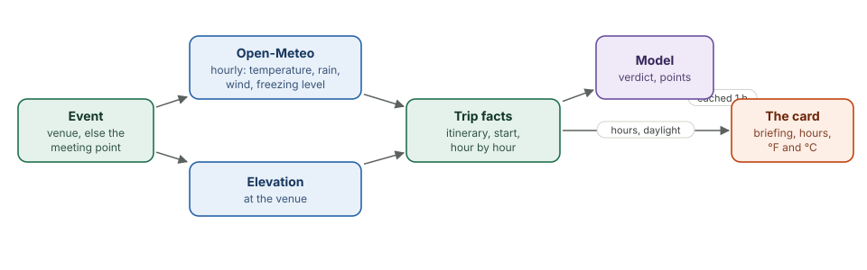

# Conditions

<div class="covers" markdown="1">

This chapter covers

- Where the forecast is taken, and why the venue matters
- The hourly forecast around the start
- How the model's briefing is made, checked and cached

</div>

## 5.1 The venue, not the meeting point

The first version showed the forecast at the meeting point. For the test hike,
that was a park-and-ride at 272 ft; the trail was at Paradise, at 5,440 ft. A
daily high and low for a parking lot said nothing useful about the hike.

`trip::conditions` now takes the forecast and elevation at the event's
**venue** when it has one, else at the meeting point, and names the place on
the card: "At Jackson Visitor Center".

## 5.2 Hour by hour

<figure>

<figcaption><b>Figure 5.1</b> From an event to its Conditions card.</figcaption>
</figure>

One Open-Meteo request returns the daily summary and the hourly forecast for
16 days. The app keeps the hours from one hour before the start to nine
hours after it, each with:

| Field | Why it is there |
|---|---|
| temperature and feels-like | wind makes 2 °C feel like −3 °C |
| chance and amount of precipitation, snowfall | the hour rain or snow starts |
| WMO weather code | the sky: clear, cloud, fog, rain, snow, thunder |
| wind and gusts | ridges and open water |
| freezing level | whether snow and ice reach the trail's elevation |

Conditions are cached for 30 minutes per event and dropped when the event is
edited. Before the event is within 16 days there is no forecast; the card says
when it will appear.

## 5.3 The briefing

The page asks for the briefing after it draws (`GET /api/events/{id}/briefing`).
The model gets the trip facts, including every hour as a line:

```text
13:00: 6 °C (feels 2 °C), mainly clear, precipitation chance 20% (0.0 mm), wind 8 km/h gusting 15, freezing level 2130 m
```

and answers with a verdict (`great`, `good`, `mixed`, `poor`), a headline of
at most 14 words, and two to four points, each tagged `timing`, `wear`,
`safety`, `comfort` or `road`. One answer for the test hike:

> **Good conditions.** Cool, breezy wildflower walk with late snow risk.
> - The 1:09 PM start is ideal, as conditions are dry and clear until 4:00 PM.
> - Pack layers for 43°F highs and 34°F lows with wind chill making it feel like 35°F or colder, especially near sunset.

The briefing is written in the reader's units (`?units=imperial` for US
English browsers), with both temperature scales. It is cached for an hour per
event and unit system, and dropped when the event changes. The first request
took 4.5 s; later ones are instant.

## 5.4 On the card

Under the briefing, a strip of hours shows the sky, the temperature in both
scales, the chance of rain as a small bar, and the wind. The start hour is
outlined, hours after sunset are shaded, and sunset is marked on its hour.
Below the strip: high and low, daylight, the freezing level when it comes
within 600 m of the venue's elevation, the UV index when it is 3 or more, and
the elevation in feet and metres.
