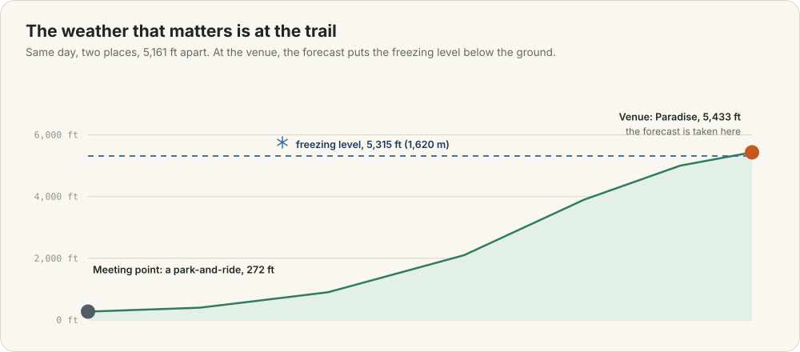
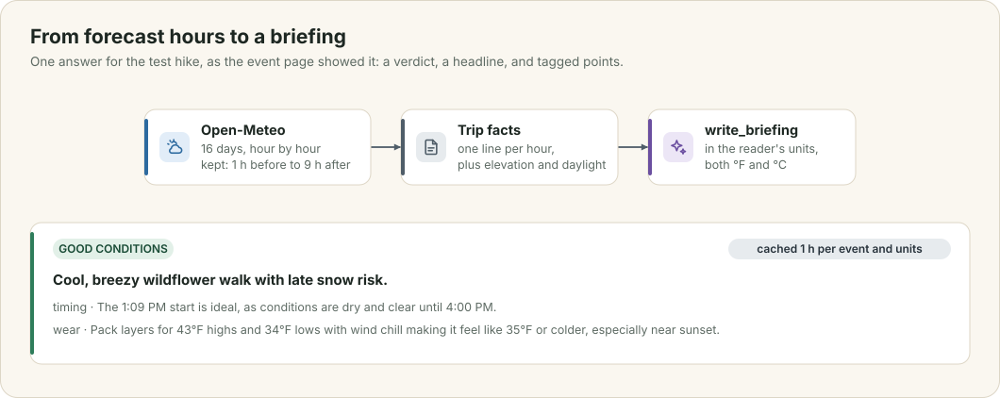
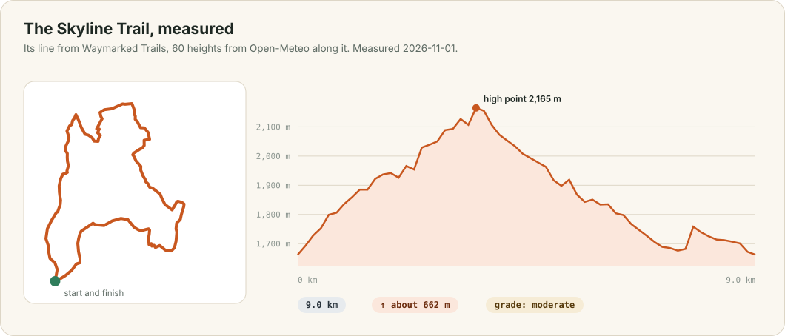

# Conditions

Before Ada's group sets off, they want to know three things: what the weather will do, hour by hour, where they will be walking; what that means for what to wear and when to turn back; and what the trail itself is like. This chapter explains where the app takes the forecast and why the place matters, how the model's briefing is made and cached, and how the Trails card finds and measures the trails near the venue.

<div class="covers" markdown="1">

This chapter covers

- why the forecast is taken at the venue, and the difference it makes
- the hours the app keeps, and what each one holds
- the briefing: the facts it reads, what it answers, and its cache
- trails near the venue: where they come from and how they are measured

</div>

## 5.1 The venue, not the meeting point

<figure>

<figcaption><b>Figure 5.1</b> Two places on the same day. The freezing level sits between them.</figcaption>
</figure>

The first version took the forecast at the meeting point. For the test hike that was a park-and-ride at 272 ft, and the walk itself was at Paradise, 5,161 ft higher. The day's high and low for a car park said nothing useful about the trail, where the freezing level on one forecast day sat below the ground.

`conditions::place_of` now chooses where to look: the event's venue if it has one, else its meeting point. The Conditions card names the place it used, such as "At Skyline Trail", so you can see which one you are reading about.

## 5.2 Hour by hour

One Open-Meteo request returns the day's summary and an hourly forecast for up to 16 days ahead. The app keeps the hours from one hour before the start to nine hours after it. Each hour holds the temperature and how cold it feels, the chance and amount of rain or snow, what the sky is doing, the wind and its gusts, and the freezing level. The sky arrives as a WMO weather code, a number from 0 to 99, which `tribe-places` turns into a `Sky` enum such as `PartlyCloudy` or `RainShowers`, so the rest of the app never handles the numbers.

The card shows a strip of these hours: the sky as an icon, the temperature in both scales with yours first, the chance of rain as a small bar, and the wind. The start hour is outlined, hours after sunset are shaded, and sunset is marked on its hour. Under the strip come the high and low, the hours of daylight, the freezing level when it comes within 600 m of the venue's elevation, the UV index when it is 3 or more, and the elevation itself.

Conditions are cached for 30 minutes per event and dropped when the event is edited. When the event is more than 16 days away there is no forecast yet, and the card says when it will appear.

## 5.3 The briefing

<figure>

<figcaption><b>Figure 5.2</b> From forecast hours to the briefing the event page showed.</figcaption>
</figure>

The page asks for the briefing once it has drawn (chapter 1). The model gets the trip facts from chapter 4, including every hour as a line it can read and you can check:

```text
13:00: 6 °C (feels 2 °C), mainly clear, precipitation chance 20% (0.0 mm), wind 8 km/h gusting 15, freezing level 2130 m
```

It answers with a verdict (`great`, `good`, `mixed` or `poor`), a headline of at most 14 words, and two to four points, each tagged `timing`, `wear`, `safety`, `comfort` or `road`. The tags choose the icons on the card, so the model never writes markup.

The briefing is written in your units. A browser set to US English asks with `?units=imperial` and gets °F, miles and 12-hour times, with every temperature also given in °C. Briefings are cached for an hour for each event and each unit system, and dropped when the event changes. The first request for the test hike took 4.5 seconds, and every later one in that hour was instant.

## 5.4 Trails nearby

<figure>

<figcaption><b>Figure 5.3</b> One trail from the Trails card, drawn from what the server measured.</figcaption>
</figure>

The weather says when to go. The Trails card says where you will walk: the named hiking routes and paths near the venue, each with its length, its climb, how far it starts from the venue, and how hard it is. Choosing one draws it on the event's map and opens its elevation profile.

The trails come from OpenStreetMap, by two routes. The first is **Waymarked Trails**, a service that publishes OpenStreetMap's marked hiking routes with their ways already in walking order. The server asks it for the routes crossing a square about 4 km around the venue, then for the details of each. The details give every way's line, in Web Mercator metres that `waymarked.rs` turns back into latitude and longitude, and every way's tags. A way tagged `sac_scale = mountain_hiking` makes the route at least `Moderate`. The route takes the hardest grade of any of its ways.

When Waymarked Trails has nothing for an area, or does not answer, the server asks **Overpass** for named paths instead. Overpass was the first choice in development, but its public servers were overloaded for most of the day this chapter was written: one answered `502`, and the others gave no answer within 40 seconds. Waymarked Trails answered in about a second every time, so Overpass became the fallback.

Each trail is then measured. `tribe-core::trails` takes 60 points along the trail's line, Open-Meteo returns the ground height at all of them in one request, and the climb is the sum of the rises along that profile, ignoring changes under 2 m as noise. The numbers are estimates: Open-Meteo's heights come from a 90 m grid, which smooths small dips and overstates steep sides. For the Skyline Trail the app reports about 662 m of climb, where the park service gives about 1,700 ft (520 m), so the card says "about" and names its sources.

The six nearest trails are measured at once and cached for six hours per event. Every map in the app can also show OpenStreetMap's marked trails as a layer, from the Waymarked Trails tile server, which you turn on from the map's layer menu.
