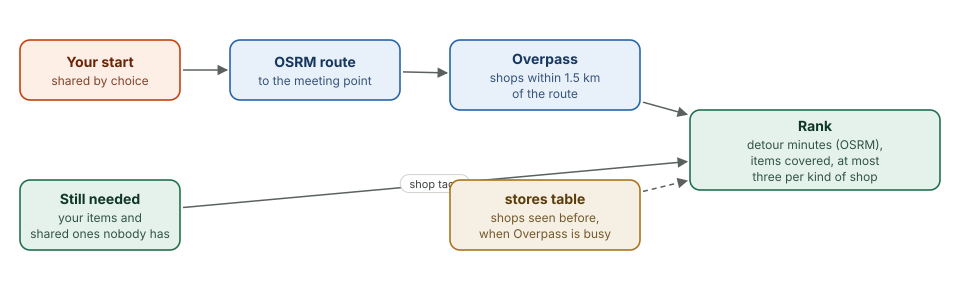

# Stores on the way

This chapter covers

- Turning "what I still need" into shops worth a stop
- The route, the corridor around it, and the detour each shop adds
- What happens when the public store search is busy

## 6.1 From a list to shops

<figure>

<figcaption><b>Figure 6.1</b> Stores on the way.</figcaption>
</figure>

"Getting there" starts from what the person still needs: their own copy of
each personal item they have not marked, and each shared item nobody is
bringing (`trip::still_needed`). Every item carries the OpenStreetMap shop
kinds the model said sell it, such as `outdoor`, `supermarket` or `chemist`.
The app does not decide which shop sells what; a store matches an item when
its own `shop` value is in the item's list.

## 6.2 Route, corridor, detour

The person shares a starting point, by choice; it is deleted a day after the
event. OSRM returns the driving route to the meeting point. Overpass is asked
for named shops of the needed kinds within 1.5 km of the route, thinned to 60
points so the query stays small. Without a starting point, the search is
6 km around the meeting point.

For up to 40 candidates, OSRM gives the extra minutes the stop adds. Ranking
(`tribe-core::recommend`) scores each store 10 points per needed item it
covers, minus 1.5 points per minute of detour; stores more than 15 minutes out
of the way are dropped. At most three stores of one kind and 12 in all are
shown, each with the items it covers and a directions link.

## 6.3 When Overpass is busy

The public Overpass servers are often overloaded. The app tries each
configured server with a 15 s limit. If none answers, it uses shops from the
`stores` cache within the same area, says so on the page, and skips Overpass
for three minutes so the next page does not wait again. The first lookup during
an outage can still take about 30 s; the ones after it take about 0.3 s.
Running Overpass for Washington on the Thor is on the roadmap.
