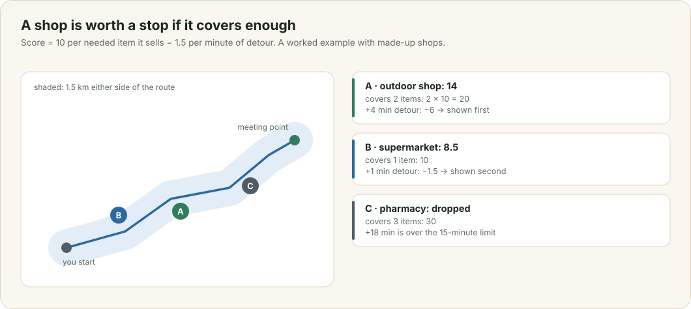

# Stores on the way

Bo still needs microspikes and the group still needs a first-aid kit. He would rather buy them on his drive than make a separate trip. This chapter follows his request from the packing list to a short list of shops, ranked by how much each one covers and how far out of his way it is.

This chapter covers

- turning "what I still need" into kinds of shop
- the route, the corridor around it, and the detour each shop adds
- the score that ranks shops
- what happens when the public store search is busy

## 6.1 From a list to kinds of shop

The Getting There tab starts from what Bo still needs. `stores_on_route::still_needed` collects his own copy of every personal item he has not ticked, and every shared item nobody has claimed. Each item carries the OpenStreetMap shop kinds that the model said sell it when it planned the list (chapter 4), such as `outdoor`, `sports` or `chemist`.

The app does not decide which shop sells what. A shop matches an item when the shop's own `shop` tag in OpenStreetMap is one of that item's kinds. Microspikes match a shop tagged `outdoor`; a first-aid kit matches one tagged `chemist`.

## 6.2 The route, the corridor and the detour

<figure>

<figcaption><b>Figure 6.1</b> How three shops are scored. The shops and numbers are made up; the rule is the app's.</figcaption>
</figure>

Bo can share where he sets off from. Only he sees it, and the hourly clean-up deletes it a day after the event (chapter 2). With a starting point, OSRM returns his driving route to the meeting point. The server thins the route to 60 points, so the query stays small, and asks Overpass for named shops of the needed kinds within 1.5 km of it. Without a starting point, it searches 6 km around the meeting point instead.

A shop near the route is not necessarily on the way. For up to 40 candidates, OSRM gives the extra minutes a stop there adds to the drive. `tribe-core::recommend` then scores each shop:

- 10 points for each needed item it sells;
- minus 1.5 points for each minute of detour;
- dropped altogether if the detour is more than 15 minutes.

In figure 6.1, shop A sells two of Bo's items for a 4-minute detour, so it scores 2 × 10 − 4 × 1.5 = 14. Shop B sells one item for 1 minute and scores 8.5. Shop C sells three items, but 18 minutes is over the limit, so it is not shown at all. The page lists at most 12 shops, and at most three of any one kind, each with the items it covers, its address and opening hours, and a link to directions from Bo's starting point.

## 6.3 When Overpass is busy

The public Overpass servers are often overloaded, as chapter 5 found too. The server tries each configured Overpass server for at most 15 seconds. If none answers, it shows shops from its own `stores` table instead: every shop any earlier search found, kept for 90 days. The page says that it is showing remembered shops. The server then skips Overpass for three minutes, so the next page does not wait again. The first lookup during an outage can still take about 30 seconds; the ones after it take about 0.3 seconds.

Running Overpass for Washington State on the Thor removes this wait, and is on the roadmap (chapter 11).
