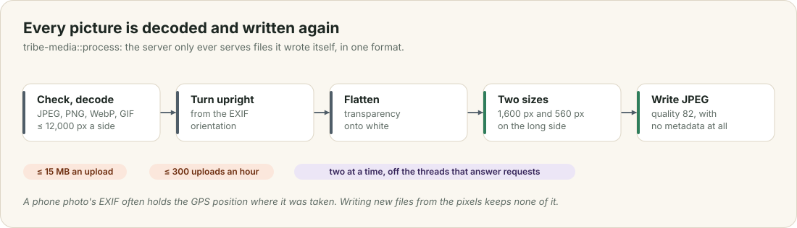
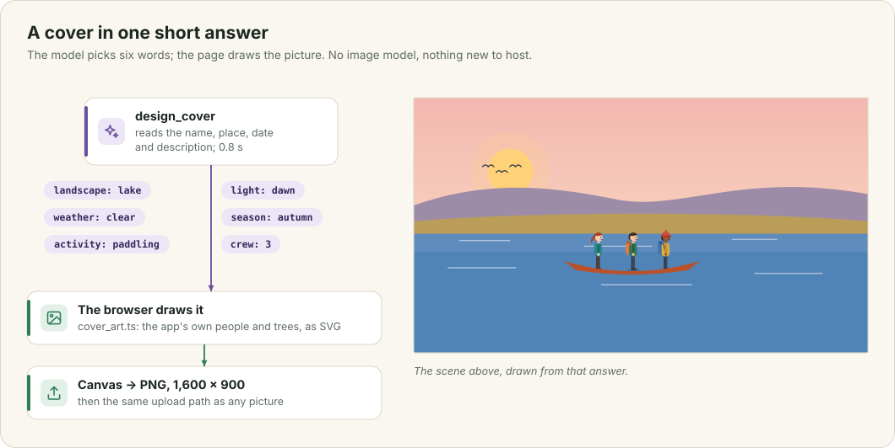

# Pictures

People put pictures in four places: a cover for a tribe or an event, a profile picture and banner, photos shared after an outing, and pictures inside a description. Every one of them goes through the same short pipeline before it is stored. This chapter explains that pipeline and why it re-encodes everything, where pictures live and who sees them, and how the model draws a cover when you have no photo.

This chapter covers

- what happens to an uploaded picture, and why every one is written again
- where pictures are kept, who can see them, and when they are deleted
- why a GIF cover loses its animation and an SVG is refused
- covers drawn from a scene the model chooses

## 7.1 The pipeline

<figure>

<figcaption><b>Figure 7.1</b> <code>tribe-media::process</code>, the path of every upload.</figcaption>
</figure>

A picture arrives as the raw body of the request, at most 15 MB, and the whole server accepts at most 300 uploads an hour. `tribe-media::process` checks the first bytes to confirm the file is a JPEG, PNG, WebP or GIF, and decodes it with a limit of 12,000 pixels a side. It turns the picture upright using its EXIF orientation, flattens any transparency onto white, makes two copies at most 1,600 and 560 pixels on the long side, and encodes both as JPEG at quality 82.

Decoding a large photo takes a few hundred megabytes of memory and a second or more of processor time. It therefore runs on Tokio's blocking pool, at most two pictures at a time behind a semaphore, and never on the threads that answer requests.

The reason for writing every picture again is privacy. A phone photo carries EXIF metadata, and that usually includes the GPS position where it was taken, which is often someone's home. A file written from the decoded pixels carries none of it. It also means the server only ever serves files it wrote itself, in one format it knows.

## 7.2 Where pictures live

Files live in the pictures folder (`OLT_MEDIA`, by default a `media` folder next to the database) as `{id}.jpg` and `{id}_s.jpg`, where the id is a lower-case UUID. A row in `images` or `inline_images`, or a column on `users`, records what each picture belongs to (chapter 2).

`GET /media/{file}` serves pictures to signed-in people only, with `Cache-Control: private, max-age=31536000, immutable`. A picture never changes under its id; a new picture gets a new id, so a browser can keep a copy for a year. The server parses the file name instead of joining it to a path, so a request for `../` cannot reach anything outside the folder.

An event's cover can be changed by its planner, the tribe's organizers and admins, and a tribe's cover by its organizers. Anyone in the tribe can add photos to its events, and a photo can be deleted by whoever shared it or by the event's managers. The hourly sweep deletes every file whose id no row mentions, so a replaced cover or a deleted photo leaves nothing behind.

## 7.3 GIF and SVG

A GIF cover loses its animation. The upload works, but the last step writes a JPEG of the first frame. Keeping animated GIFs needs a second path that checks every frame and keeps the GIF, or converts it to animated WebP, instead of re-encoding it.

An SVG is refused. SVG is a document format: a file can contain scripts and links to other servers. The server only accepts formats it can decode into pixels. SVG covers would be worth having, because they scale to any banner without cropping, but only once uploads are reduced to a safe subset of shapes, paths, gradients and text. Both changes are on the roadmap.

## 7.4 Covers the model draws

<figure>

<figcaption><b>Figure 7.2</b> The cover studio, and one drawing the model made.</figcaption>
</figure>

When you press "Draw with AI" on a tribe or event, a dialog opens and the model writes a scene for it. `describe_cover` reads the name, the place, the date and the description, and answers in 120 to 200 words as direction for an illustrator: what is in the foreground, middle and background, the light and the season, who is there and what they are doing, and the style. For "Rattlesnake Ledge slow hike and lunch" on a November morning it began: "A wide, atmospheric landscape captures the crisp chill of an early November morning at Rattlesnake Ledge."

You can change any of it, or ask for another, before pressing "Draw it". `draw_cover` then has the same model write the whole scene as one SVG document, 1,600 by 900, as free text with no JSON around it, which would only add tokens. Its instructions are about composition: fill the whole canvas, build depth with at least five layers that get lighter and bluer with distance, give the foreground texture, keep people small and seen from behind. A drawing is usually about 4,000 tokens and takes about a minute on the Thor; the dialog shows the seconds counting. No part of the picture comes from a template, so two drawings of the same scene differ.

An SVG is a document that can carry scripts, event handlers and links to other servers, so the server cleans every drawing before anyone sees it. `tribe-media::svg::clean_svg` parses it with an XML reader and rebuilds it from an allow-list: fourteen drawing elements, such as `path`, `linearGradient` and `circle`, and geometry and paint attributes only. Anything else is dropped together with everything inside it: `<script>`, `<foreignObject>`, `<text>`, every `on…` handler, `style`, and any `url(...)` that points outside the drawing. A document whose outermost element is not `<svg>` is refused.

The dialog shows the cleaned drawing as an image. When you choose "Use as cover", a canvas turns it into a 1,600 × 900 PNG, and the PNG goes through the upload pipeline in figure 7.1 like any photo, so what is stored is an ordinary JPEG.

The drawings are flat and simple next to an image model's paintings, and the model sometimes draws a shape where you meant a path. They cost nothing new to run: no image model to download or host, just two answers from the model that already serves the app.

The book's chapter openers are drawn differently, by `cover_art.ts`, an illustration template with the app's ten people, so that the book's pictures stay the same from one build to the next.
