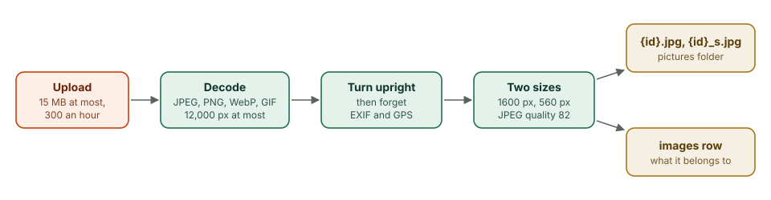

# Pictures

This chapter covers

- What happens to an uploaded picture, and why every one is re-encoded
- Where pictures live, who can see them, and when they are deleted
- Why GIF covers lose their animation and SVG is refused

## 7.1 The pipeline

<figure>

<figcaption><b>Figure 7.1</b> From upload to file.</figcaption>
</figure>

A picture arrives as the raw request body, at most 15 MB, and at most 300
uploads an hour across the server. `tribe-media::process` then:

1. checks the first bytes are a JPEG, PNG, WebP or GIF, and decodes it with
   limits of 12,000 pixels a side;
2. turns it upright from its EXIF orientation;
3. flattens transparency onto white;
4. makes two copies, at most 1,600 and 560 pixels on the long side;
5. encodes both as JPEG at quality 82.

Decoding a large photo takes a few hundred megabytes and a second or more of
CPU, so it runs on Tokio's blocking pool, two at a time behind a semaphore,
never on the threads that answer requests.

**Why re-encode everything.** A phone photo carries EXIF metadata, including
the GPS position where it was taken: often someone's home. Writing new JPEG
files from the decoded pixels keeps none of it. It also means the server only
ever serves files it wrote itself, in one format.

## 7.2 Storage and access

Files live in the pictures folder (`OLT_MEDIA`, by default `media` next to the
database) as `{id}.jpg` and `{id}_s.jpg`, where the id is a lower-case UUID.
The database records what each picture belongs to: an event cover, an event
photo, a tribe cover, a picture in a description, or a person's profile
picture or banner.

`GET /media/{file}` serves them to signed-in people only, with
`Cache-Control: private, max-age=31536000, immutable`; a picture never changes
under its id, a new one gets a new id. The file name is parsed, not joined to
a path, so `../` cannot reach anything.

Who may change what: the event's planner, the tribe's organizers and admins
set an event's cover; organizers set a tribe's; anyone in the tribe adds
photos; whoever shared a photo, or the event's managers, can delete it.

The hourly sweep deletes any file whose id no row mentions, so a replaced
cover or a removed photo leaves nothing behind.

## 7.3 GIF and SVG

**A GIF cover loses its animation.** The upload works, but step 5 writes a
JPEG of the first frame. Keeping animated GIFs needs a second path that checks
every frame and keeps the GIF (or converts it to animated WebP) instead of
re-encoding.

**SVG is refused.** An SVG is a document, not a picture: it can contain
scripts and links to other servers. The server accepts only formats it can
decode to pixels. An SVG cover would scale to any banner without cropping, so
it is worth supporting once uploads are reduced to a safe subset of SVG: shapes,
paths, gradients and text, with no scripts, no external references and no
embedded HTML.

Both are on the roadmap, with choosing which part of a photo shows in a banner.
