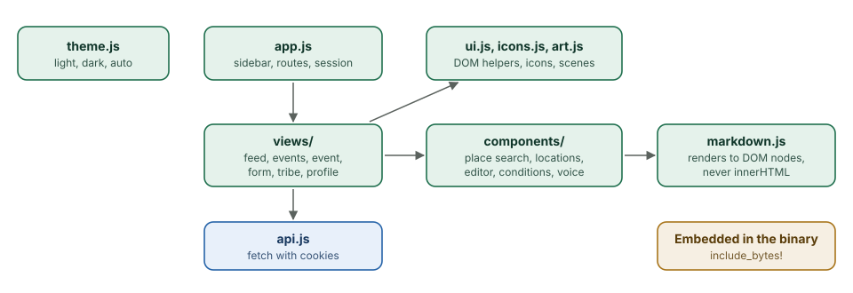

# The web app

This chapter covers

- How the web app is organised without a framework or a build step
- Themes, illustrations and the design tokens behind them
- The Markdown editor and renderer, and why the renderer never uses innerHTML
- Voice input

## 8.1 Shape

<figure>

<figcaption><b>Figure 8.1</b> The modules of the web app.</figcaption>
</figure>

The web app is ES modules loaded straight by the browser. `index.html` loads
two scripts: `theme.js`, which runs before the page draws, and `app.js`, which
routes on the URL hash (`#/events/abc`). Each route is a view in `views/` that
draws its page from `h(tag, attributes, ...children)`, a short helper that
creates elements and adds every string as a text node. Pieces used by more
than one page are in `components/`: the place search box, the locations
editor, the Markdown editor, the plan assistant, the Conditions card, the
picture picker and the voice button.

There is no build step. The server embeds the files with `include_bytes!` and
serves them with `no-cache`, so a new binary is a new web app on the next
reload. Leaflet, for the maps, and the Inter font are vendored.

## 8.2 Look

Colours, spacing and radii are CSS variables on `:root`, redefined for dark
mode under `[data-theme="dark"]`. `theme.js` sets that attribute from the
person's saved choice or, on Auto, from the system setting, and follows the
system as it changes. The sidebar has a labelled Light, Dark and Auto switch.
In dark mode the map tiles are inverted and dimmed with a CSS filter, so the
map does not glare.

The illustrations in `art.js` are SVG built as strings from a few parts: a
person with legs, arms and a head that can walk, wave or stand, a pine tree, a
cloud, a bird. CSS animates them: legs swing, arms wave, eyes blink, clouds
drift, the sun's rays turn. Their colours are `--art-*` variables, so the day
scene becomes a night scene in dark mode. `prefers-reduced-motion` stops every
animation.

## 8.3 Markdown

Descriptions are Markdown. The editor (`components/markdown_editor.js`) has a
toolbar for headings, bold, italic, strikethrough, lists, checklists, quotes,
links, pictures, code and dividers; Write and Preview tabs; starting outlines;
a help panel; and Write with AI (chapter 4). Lists continue when Enter is
pressed, and pictures can be pasted or dropped into the text.

The renderer (`markdown.js`) builds DOM nodes directly instead of producing
HTML. Text people wrote is always added as text nodes, so `<script>` in a
description is shown as the characters `<script>`. Links are kept only for
`http`, `https` and `mailto`, and open with `rel="noopener noreferrer nofollow"`.
Pictures are shown only when they point at this server's own uploads
(`media/{uuid}.jpg`); any other image URL becomes a plain link, so a
description cannot make readers' browsers fetch from another server.

## 8.4 Voice

The microphone buttons use the browser's speech recognition
(`SpeechRecognition`), which Chrome, Edge and Safari provide. Words appear in
the box as they are recognised. Two limits come from the browsers: the
microphone is only allowed on HTTPS pages (or `localhost`), and Chrome sends
the audio to Google to recognise it. Recognition on the Thor itself is on the
roadmap.
