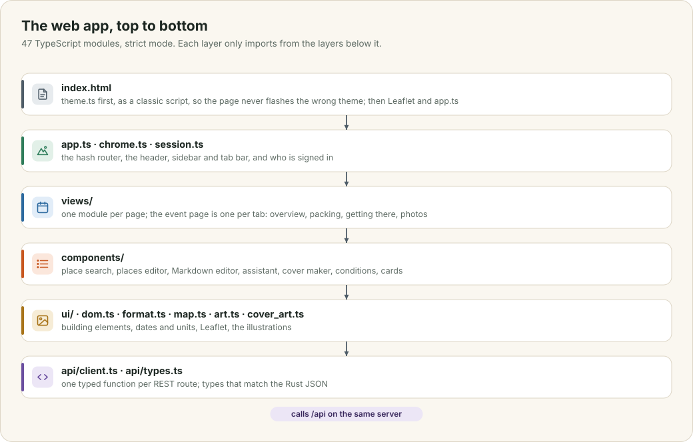
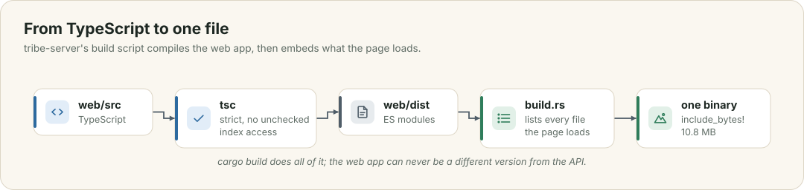

# The web app

The web app is 49 TypeScript modules and one stylesheet, with no framework. It is compiled by the server's own build, embedded in the binary, and served from the same address as the API. This chapter shows how the modules are layered, how the build works, and how a few parts that people touch most are put together: the search page, the editors and assistants, the themes, and the layout on phones.

This chapter covers

- the layers of the app, and the one rule between them
- how the TypeScript becomes part of the binary
- building pages without a framework, safely
- search, places, writing and voice
- twelve themes, and a layout that fits a phone

## 8.1 Layers

<figure>

<figcaption><b>Figure 8.1</b> The modules in layers. Each imports only from the layers below it.</figcaption>
</figure>

`index.html` loads `theme.ts` first, as a plain script in the page's head, so the right colours are set before anything draws. Then come Leaflet and `app.ts`, which holds the router: a table of patterns such as `/events/([^/]+)` matched against the address after the `#`, each with a function that draws one page. `chrome.ts` draws the frame around every page: the sidebar on wide screens, the header with search and Back, and the tab bar on phones. `session.ts` holds who is signed in.

Each page is a module in `views/`. The event page, the largest, is a folder with one module per tab (overview, packing list, getting there, photos) and a small `EventScreen` interface that every tab receives: the event's details, the person signed in, and three things a tab may ask the page to do: reload, update the details in place, or open another tab. Pieces used on several pages, such as the place search box, the Markdown editor and the Trails card, live in `components/`. At the bottom, `api/client.ts` has one typed function for each route of the API, and `api/types.ts` has an interface for every shape of JSON the Rust server sends.

The compiler runs in strict mode with `noUncheckedIndexedAccess`, so `list[0]` has a type that may be `undefined`, and the code must say what happens then.

## 8.2 From TypeScript to the binary

<figure>

<figcaption><b>Figure 8.2</b> One <code>cargo build</code> compiles the web app and embeds it.</figcaption>
</figure>

`tribe-server` has a build script, `build.rs`. When anything under `web/src`, the stylesheet or the page changes, it runs the project's own `tsc`, then walks `web/` and writes a Rust file listing every file the page loads, each as `include_bytes!`. `web.rs` includes that list and serves from it. Adding a module never means editing Rust, and the binary always carries the web app it was built with. You run `npm ci` once in `web/` to get the compiler; if it is missing, the build says so.

## 8.3 Building pages

The views build elements with one function, `h(tag, attributes, ...children)`, from `dom.ts`. Text that people wrote always goes into the page as a text node, so a tribe named `<script>` shows those characters and runs nothing. The one exception is the `html` attribute, which only the app's own icons and drawings use.

Markdown descriptions are rendered by `markdown.ts`, which reads the text line by line and builds DOM nodes. It never produces an HTML string, so there is nothing for a crafted description to escape from. Links are limited to `http`, `https` and `mailto`, and pictures to the app's own `/media`.

## 8.4 Search, places and writing

**The search page** asks two questions at once. `GET /api/search` answers from the search index in chapter 2 in milliseconds, and the page draws those results immediately. `GET /api/search/related` asks the model for related words and answers those from the same index about a second later. The page adds the new results under "Related" and leaves out anything already shown. The filter boxes on the Tribes and Events pages use the same index, so "ai replacing" finds "ai-won't-replace-us" there too.

**The place search box**, `components/place_search.ts`, runs the two lanes from chapter 3, keeps the arrow keys and Enter working across both lists, and ignores an answer that arrives after a newer search has started.

**The Markdown editor** has a toolbar for headings, lists, checklists, links and pictures, keyboard shortcuts, lists that continue when you press Enter, pictures by paste or drop, and a preview. Its Write with AI menu sends the form's details and an instruction to the model (chapter 4), and puts the answer in through the browser's own undo history, so Ctrl+Z restores what was there before.

**The assistants** on the event and tribe forms take your plan in your own words, typed or spoken, and fill in the form. Voice uses the browser's speech recognition, which works only on HTTPS pages. In Chrome, that recognition runs on Google's servers, which is why moving speech onto the Thor is on the roadmap.

## 8.5 Themes

The app has twelve themes: two light and ten dark. The dark ones include the themes of the editor this project is written in: Material Deep Ocean, Night Owl, Oceanic Next, Nord, Catppuccin Mocha, Tokyo Night, Kanagawa, Rosé Pine and Everforest. You choose one from a picker that shows a small preview of each, or let the app follow your device between Evergreen's light and dark versions.

Every colour in the stylesheet is a variable, such as `--surface`, `--text` or `--accent`. A theme is a block that sets those variables under `:root[data-palette="nord"]`, so adding a theme changes no other rule. A second attribute, `data-theme`, says whether the theme is light or dark; the illustrations switch to night skies and the map dims its tiles from that one attribute. `theme.ts` saves your choice and applies it before the page draws, so it never flashes the wrong colours.

## 8.6 On a phone

On a narrow screen the sidebar becomes a drawer, a tab bar appears at the bottom, and every two-column layout becomes one column. Three rules keep that one column from becoming wider than the phone.

Grids that collapse use `minmax(0, 1fr)`, not `1fr`. A `1fr` column can never be narrower than its widest content, so one long place name or one card with a minimum width pushed the whole page sideways. Long words wrap anywhere they must (`overflow-wrap: anywhere`) inside headings, paragraphs and list items.

Text boxes use 16-pixel text on phones. iOS Safari zooms the whole page into any text box with smaller text when you tap it, and leaves it zoomed, which looked like boxes spilling out of their cards. For the same reason, date and time inputs drop Safari's own minimum width, and picture drop areas take their width from the column, because Safari otherwise works a box's width out backwards from its minimum height and shape.

These fixes were checked by opening every page in Chromium at 390, 768, 1024, 1440 and 1920 pixels wide and measuring it: no page scrolls sideways, no element sticks out of its parent, and no two siblings overlap. Chromium does not reproduce Safari's zoom, so the iOS rules above come from Safari's documented behaviour and still need confirming on an iPhone.
