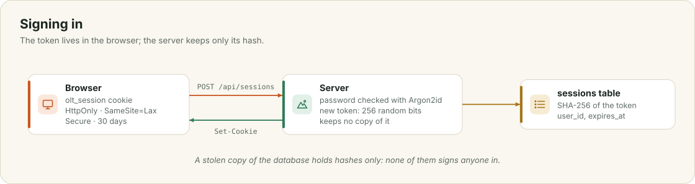

# Security and privacy

The app holds people's names, their plans, where they set off from, and their photos, and it is reachable from the whole internet. This chapter explains how accounts and sessions work, who may change what, what the browser is allowed to load, and what the app keeps about people and sends elsewhere. It ends with the gaps that remain.

<div class="covers" markdown="1">

This chapter covers

- passwords, session tokens and the cookie that carries them
- who may see and change what, and where that is checked
- the content security policy, and keeping people's text out of the page's code
- what is kept, for how long, and what leaves the machine
- the gaps that remain

</div>

## 9.1 Signing in

<figure>

<figcaption><b>Figure 9.1</b> The token lives in the browser; the database holds only its hash.</figcaption>
</figure>

A password must be at least 10 characters. It is stored as an **Argon2id** hash with its own random salt, so two people with the same password have different hashes, and checking a guess costs real time and memory.

When Ada signs in with `POST /api/sessions`, the server checks her password, creates a random 256-bit token, and sends it to her browser in a cookie:

```text
olt_session=…; Path=/; HttpOnly; SameSite=Lax; Max-Age=2592000; Secure
```

The database keeps only the SHA-256 of the token. Someone holding a copy of the database cannot sign in as anyone, because the tokens themselves are not in it. `HttpOnly` keeps the token out of reach of the page's scripts. `SameSite=Lax` stops other sites from sending it along with their requests. `Secure` keeps it off plain HTTP; it is turned off only for testing on your own machine, with `OLT_INSECURE_COOKIE`. A session lasts 30 days, and `DELETE /api/sessions/current` ends it.

A wrong password answers `401 Unauthorized`, the same status as no session at all. Two limits slow down guessing: at most 30 new accounts an hour and at most 60 failed sign-ins in ten minutes, each counted across the whole server. The first account on a new server becomes its admin.

## 9.2 Who may do what

| Action | Allowed for |
|---|---|
| See tribes, events, people and pictures | anyone signed in |
| Create an event in a tribe, add to its lists, share photos | members of that tribe |
| Edit or delete an event, change its cover | its planner, the tribe's organizers, admins |
| Edit a tribe, change its cover | its organizers, admins |
| Delete a photo | whoever shared it, the event's managers, admins |
| Change a profile, profile picture or banner | the person themselves |

Each rule is checked in the route handler before anything is written, by a small function such as `require_member` or `managed_event` that answers `403 Forbidden` when the rule fails. The rules were tested by calling every write route as someone who is not allowed and checking for `403`. That was done by hand; automated tests for it are on the roadmap.

## 9.3 What the browser may load

Every file of the web app is served with these headers:

```text
Content-Security-Policy: default-src 'self'; script-src 'self'; style-src 'self' 'unsafe-inline';
  img-src 'self' data: blob: https://*.tile.opentopomap.org https://tile.openstreetmap.org
          https://tile.waymarkedtrails.org https://server.arcgisonline.com;
  connect-src 'self'; font-src 'self'; frame-ancestors 'none'; base-uri 'none'; form-action 'self'
X-Content-Type-Options: nosniff
X-Frame-Options: DENY
```

Scripts can come only from the app itself. Even if some text did reach the page as markup, the browser would not run code from it. Pictures can come only from the app, its uploads, and the four map tile servers. No other site can put the app in a frame. Inline styles are allowed because the page sets `style` attributes on elements it builds, such as a cover's gradient; inline scripts are not.

Inside the app, people's text never becomes markup in the first place. Views add it as text nodes, and the Markdown renderer builds elements instead of HTML strings (chapter 8). Uploaded pictures are decoded and written again before they are stored, and the model's SVG drawings are cut down to plain drawing elements before anyone sees them (chapter 7).

## 9.4 What is kept, and what leaves

| Data | Kept | Seen by |
|---|---|---|
| Name, bio, home area, pictures | until changed | everyone signed in |
| Email | until the account is deleted | only its owner |
| Where you set off from | until a day after the event | only you; used to find shops |
| Events and everything attached | a year after the event | everyone signed in |

The model runs on the same machine, so plans, descriptions, starting points and searches are never sent to a model company. Some requests do leave the machine: place searches go to Photon or Nominatim, event coordinates go to Open-Meteo, Waymarked Trails and Overpass, and routes go to OSRM. None of these requests carries a name or an account. Voice input in Chrome is recognised on Google's servers (chapter 8), and map tiles load from their tile servers straight from your browser.

## 9.5 Gaps

There is no email verification and no password reset yet. Tribes are open to everyone signed in, with no private tribes. Anyone who can open the public address can create an account; the limits in section 9.1 slow abuse down, but because they are counted across the server, a flood of sign-ups would also block real ones. All three are on the roadmap.
