# Security and privacy

<div class="covers" markdown="1">

This chapter covers

- Accounts, passwords and sessions
- Who may see and change what
- What the browser is allowed to load
- What the app keeps about people, and what it never sends anywhere

</div>

## 9.1 Accounts and sessions

Passwords are at least 10 characters and are stored as **Argon2id** hashes with
a fresh salt each. Signing in creates a random 256-bit token, sent to the
browser in a cookie:

```text
olt_session=…; Path=/; HttpOnly; SameSite=Lax; Max-Age=2592000; Secure
```

The database keeps only the SHA-256 of the token, so a copy of the database
cannot be used to sign in. `HttpOnly` keeps the token away from page scripts;
`SameSite=Lax` stops other sites from sending it with their requests; `Secure`
keeps it off plain HTTP (it is turned off only for local testing with
`OLT_INSECURE_COOKIE`). A session lasts 30 days.

Two limits slow down guessing: at most 30 new accounts an hour, and at most
60 failed sign-ins in 10 minutes, across the server. The first account on a
new server becomes its admin.

## 9.2 Who may do what

| Action | Allowed for |
|---|---|
| See tribes, events, people, pictures | anyone signed in |
| Create an event in a tribe; add list items; share photos | members of that tribe |
| Edit or delete an event; change its cover | its planner, the tribe's organizers, admins |
| Edit a tribe; change its cover | its organizers, admins |
| Delete a photo | whoever shared it, the event's managers, admins |
| Change a profile, picture or banner | the person themselves |

Each rule is checked in the route handler before anything is written
(`require_member`, `managed_event`, `require_organizer`). They were tested by
hand, calling the routes as someone who is not allowed and getting `403`;
automated tests for them are on the roadmap.

## 9.3 What the browser may load

Every web file is served with:

```text
Content-Security-Policy: default-src 'self'; script-src 'self'; style-src 'self' 'unsafe-inline';
  img-src 'self' data: blob: https://*.tile.opentopomap.org https://tile.openstreetmap.org;
  connect-src 'self'; font-src 'self'; frame-ancestors 'none'; base-uri 'none'; form-action 'self'
X-Content-Type-Options: nosniff
X-Frame-Options: DENY
```

Scripts come only from the app itself, so even text that slipped into the page
as markup could not run code. Pages cannot be framed. Images come only from
the app, its uploads and the two tile servers. Inline styles are allowed
because the DOM helpers set `style` attributes; no inline scripts are.

Inside the app, text people write never becomes markup: views add it as text
nodes, and the Markdown renderer builds DOM nodes (chapter 8). Pictures are
re-encoded before they are stored (chapter 7).

## 9.4 What the app keeps

| Data | Kept | Seen by |
|---|---|---|
| Name, bio, home area, pictures | until changed | everyone signed in |
| Email | until the account is deleted | only its owner |
| Where you start from | until a day after the event | only you; used to find stores |
| Events and everything attached | a year after the event | everyone signed in |
| Photos | with their event | everyone signed in |

The model runs on the same machine, so plans, descriptions and starting points
are never sent to a model company. What does leave the machine: place searches
go to Photon or Nominatim, event coordinates to Open-Meteo, and routes and
store searches to OSRM and Overpass. None of these requests carries a name or
an account. Voice input in Chrome is recognised by Google (chapter 8).

## 9.5 Known gaps

- No email verification and no password reset.
- Tribes are open to everyone signed in; there are no private tribes yet.
- Anyone who can open the public address can create an account. The limits in
  9.1 slow abuse but do not stop a determined one.
