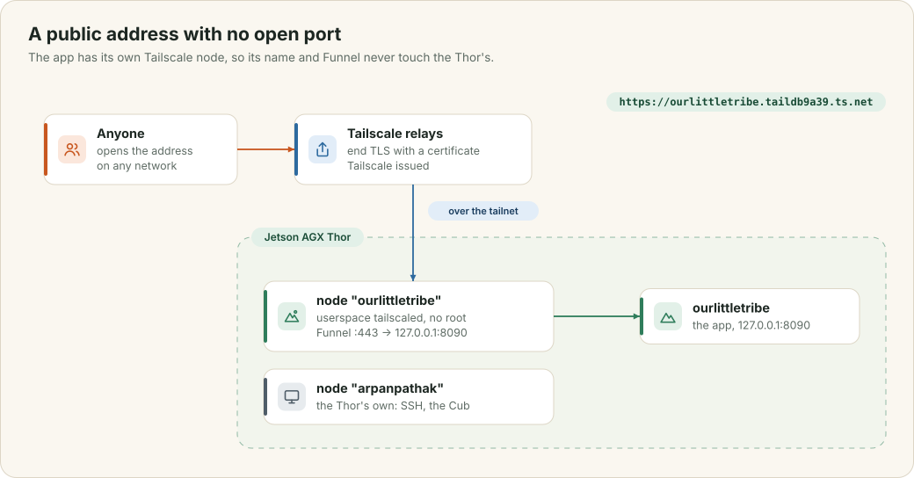

# Going live

The app runs on a Jetson Thor in a house, behind a home router. This chapter explains how it got a public HTTPS address with no domain and no open port, why it has a Tailscale node of its own, what runs on the Thor, and how a new version gets there.

<div class="covers" markdown="1">

This chapter covers

- a public address through Tailscale Funnel
- why the app runs its own Tailscale node beside the Thor's
- the services on the Thor, and where the data lives
- deploying, and what to do before more people use it

</div>

## 10.1 An address without a domain

<figure>

<figcaption><b>Figure 10.1</b> The path from a browser to the app, and the two Tailscale nodes on the Thor.</figcaption>
</figure>

**Tailscale Funnel** publishes one port of a machine on your tailnet to the whole internet, at `https://<machine>.<tailnet>.ts.net`. A visitor's browser connects to Tailscale's relays, which end the TLS connection with a certificate that Tailscale issues, and pass the traffic over the tailnet to the machine. The router opens no port.

The address has two parts. The machine name is chosen by you. The tailnet name, here `taildb9a39`, is chosen by Tailscale. You can swap it once for a generated name in the admin console, but you cannot set it to any text you like, and changing it changes every address on the tailnet. An address like `ourlittletribe.ts.net` with no tailnet part is not available on `ts.net`. Getting your own name in the address bar, such as `ourlittletribe.voltforge.tech`, needs a domain and a proxy that answers for it, such as Cloudflare Tunnel; a page that only redirects would still show the `ts.net` address.

## 10.2 A node of its own

The Thor's own Tailscale node is called `arpanpathak`, and it already publishes another app, the Tigress Cub, through Funnel. Renaming it would have moved the Cub. So the app has its own node, `ourlittletribe`, running on the same Thor as a second `tailscaled`:

```ini
ExecStart=/usr/sbin/tailscaled --tun=userspace-networking --port=0 \
  --statedir=%h/.local/share/ourlittletribe/tailscale \
  --socket=%t/ourlittletribe-tailscaled.sock
```

`--tun=userspace-networking` runs the node without a network interface, so it needs no root and cannot affect the Thor's own networking. Its state and socket live in the user's own directories, apart from the system node's. Funnel on this node sends its port 443 to the app:

```bash
tailscale --socket=$XDG_RUNTIME_DIR/ourlittletribe-tailscaled.sock funnel --bg http://127.0.0.1:8090
```

Because the two apps have different host names, they never share cookies or browser storage. When Funnel was first turned on, about half the connections failed for a minute while the new certificate reached Tailscale's relays. After that, 20 requests out of 20 succeeded.

## 10.3 What runs on the Thor

Everything runs as `systemd --user` services, kept running after logout with lingering turned on:

| Service | Listens on | Does |
|---|---|---|
| `ourlittletribe` | `127.0.0.1:8090` | the app |
| `ourlittletribe-tailscale` | the tailnet | the `ourlittletribe` node and its Funnel |
| `thor-edge-llm` | `127.0.0.1:8081` | TensorRT Edge-LLM serving Qwen3.6 |
| the system's `tailscaled` | the tailnet | the `arpanpathak` node: SSH, and the Cub's Funnel |

The app's data is in `~/.local/share/ourlittletribe/`: the database `ourlittletribe.db` and the `media` folder beside it.

## 10.4 Deploying

```bash
deploy/deploy.sh
```

The script installs the web app's compiler with `npm ci` if it is missing, builds the release binary on the Orin development board (aarch64, like the Thor), copies the binary and both service files to the Thor, restarts the app and checks `/health`. A deploy costs a few seconds of downtime while the process restarts, and the schema updates itself on start (chapter 2).

The first time only, the `ourlittletribe` node must be signed in to the tailnet with a login link, and Funnel turned on; the script prints both commands. After that the node keeps its identity in its state directory.

## 10.5 Before more people use it

The database and the pictures are one folder, and nothing copies it off the Thor yet; a nightly backup is the first thing to add. Sign-ups are open to anyone with the address, and the limits in chapter 9 are counted across the server. The public map services are the least reliable part of the system (chapters 3, 5 and 6). Each has a fallback, but the lasting fix is running them on the Thor.
