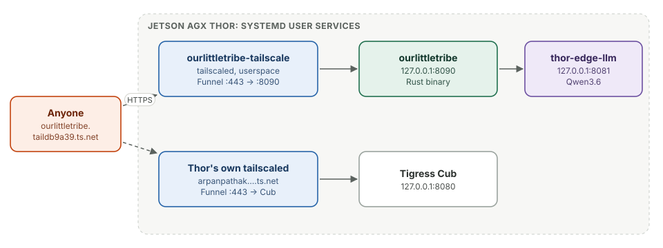

# Going live

<div class="covers" markdown="1">

This chapter covers

- How the app gets a public HTTPS address with no domain and no open port
- Why it runs its own Tailscale node beside the Thor's
- Deploying, and what runs where on the Thor

</div>

## 10.1 An address without a domain

<figure>

<figcaption><b>Figure 10.1</b> Two Tailscale nodes on one Thor, each with its own name and its own app.</figcaption>
</figure>

**Tailscale Funnel** publishes a port of a machine on a tailnet to the whole
internet, at `https://<machine>.<tailnet>.ts.net`. Tailscale's relays take the
connection and pass it over the tailnet to the machine; the router opens no
port, and Tailscale issues the TLS certificate.

The name is made of two parts:

- **The machine name.** The Thor's node is called `arpanpathak` and already
  publishes the Tigress Cub.
- **The tailnet name**, here `taildb9a39`, is chosen by Tailscale. It can be
  swapped once for a generated "fun name" in the admin console (DNS → Rename
  tailnet), but it cannot be set to arbitrary text, and changing it changes
  every address on the tailnet.

A name like `ourlittletribe.ts.net`, with no tailnet part, is not possible on
`ts.net`; that needs a domain.

## 10.2 A second node

Renaming the Thor would have moved the Tigress Cub. Instead the app has its own
Tailscale node, `ourlittletribe`, running on the same Thor:

```ini
ExecStart=/usr/sbin/tailscaled --tun=userspace-networking --port=0 \
  --statedir=%h/.local/share/ourlittletribe/tailscale \
  --socket=%t/ourlittletribe-tailscaled.sock
```

`--tun=userspace-networking` runs the node without a network interface, so it
needs no root and cannot affect the Thor's own networking. Its state and
socket live in the user's directories, apart from the system node's. Funnel
on this node sends its port 443 to `127.0.0.1:8090`:

```bash
tailscale --socket=$XDG_RUNTIME_DIR/ourlittletribe-tailscaled.sock funnel --bg http://127.0.0.1:8090
```

The result is **https://ourlittletribe.taildb9a39.ts.net** on the standard
port. Because it is a different host name from the Cub, the two apps never
share cookies or browser storage. On the first request after Funnel was turned
on, about half the connections failed for a minute while the new certificate
reached both of Tailscale's relays; after that, 20 of 20 requests succeeded.

## 10.3 What runs on the Thor

All of these are `systemd --user` services, kept running after logout with
lingering enabled:

| Service | Listens on | Does |
|---|---|---|
| `ourlittletribe` | `127.0.0.1:8090` | the app |
| `ourlittletribe-tailscale` | (tailnet) | the `ourlittletribe` node and its Funnel |
| `thor-edge-llm` | `127.0.0.1:8081` | TensorRT Edge-LLM with Qwen3.6 |
| the Thor's `tailscaled` | (tailnet) | the `arpanpathak` node: SSH, the Cub's Funnel |

The app's data is in `~/.local/share/ourlittletribe/`: the database
`ourlittletribe.db` and the `media` folder next to it.

## 10.4 Deploying

```bash
deploy/deploy.sh
```

builds the release binary on the Orin development board (aarch64, the same
architecture as the Thor), copies it and both service files to the Thor,
restarts the app, and checks `/health`. A deploy is a few seconds of downtime
while the process restarts. The database schema updates itself on start
(chapter 2).

The first time only, the `ourlittletribe` node must be signed in to the
tailnet with a login link, and Funnel turned on; the script prints both
commands. After that the node keeps its identity in its state directory.

## 10.5 Before more people use it

- **Backups.** The database and pictures are one folder; it should be copied
  off the Thor every night.
- **Abuse.** Anyone with the address can sign up. The sign-up and sign-in limits
  (chapter 9) are per server, not per address, so a flood of sign-ups can also
  block real ones.
- **The public map services** are the least reliable part (chapters 3 and 6).
  Each has a fallback, but the real fix is running them on the Thor.
