# Roadmap

The full list, with what "done" means for each item, is in [`ROADMAP.md`](https://github.com/arpanpathak/ourlittletribe/blob/main/ROADMAP.md). This chapter explains the design behind the larger items, in the order they are likely to happen.

## 11.1 The map services on the Thor

Every slow or failed request in chapters 3, 5 and 6 came from a public service: Photon refusing connections, Nominatim's one request a second, and Overpass answering `502` or nothing at all. All three can run on the Thor from one OpenStreetMap extract of Washington State.

The place index is the first. Every named place in the extract would be read with a Rust PBF reader and stored in SQLite with an FTS5 trigram index on the names, the same kind of index that chapter 2 already uses for tribes and events. "javkson" shares "kso" and "son" with "jackson", so a typo still finds the place. Candidates would be ranked by how closely each typed word matches a word of the name, by how notable the place is, and by distance. Each place keeps its OpenStreetMap kind, so "hiking" can become a query for trailheads and peaks near you with no network call. The model's steps from chapter 3 stay the same; their lookups become local and take milliseconds.

OSRM for routes, Overpass for shops, and a copy of Waymarked Trails' routes follow, from the same extract.

## 11.2 Pictures

A cover will store a **focal point**, which you set by dragging the picture inside its frame and which every page applies with `object-position`. Animated GIFs will be kept as GIF or converted to animated WebP after every frame is checked, instead of keeping only the first frame. SVG covers, which fit any frame without a focal point, will be accepted once uploads are reduced to safe elements and served with a policy that forbids scripts.

## 11.3 The model

The briefing's numbers will be checked against the facts it was given: every number in the text found and compared with the forecast lines, and any sentence that disagrees dropped (chapter 4). Speech recognition will move onto the Thor, with Whisper on TensorRT, so voice works over plain HTTP and no audio leaves the house. And the assistants will read a picture: a flyer or a screenshot of a trail page, filling in the form as the typed assistant does.

## 11.4 People

Private tribes with invitations, comments on events, notifications before an event and when it changes, and carpools: who drives, who has seats, and who needs a ride from where. Password reset, email verification and automated tests of who may do what (chapter 9) come before any of these.
