# Introduction



OurLittleTribe is a web app for planning outings with a small group of people. A **tribe** is the group: friends who hike, a running club, families who picnic. An **event** is one outing. It has a meeting point, perhaps stops on the way and a venue, a start time, a packing list that everyone going can see and tick off, and the photos people share afterwards.

This book explains how the app is built and why each part works the way it does. It is written for you if you will change the code, run the app yourself, or build something similar. Each chapter takes one part of the system, shows it working on a real example, and then explains the decisions behind it, including the ones that did not work the first time.

## The running example

Most chapters follow one plan. Ada organises the Cascade Morning Walkers, a tribe of friends around Seattle. She plans a hike on the Skyline Trail at Paradise, on Mount Rainier. Bo, Cy and Dee say they are going. You will see Ada's plan stored (chapter 2), her place search for "mt rainier henry jackson" turned into the Jackson Visitor Center (chapter 3), the model writing her packing list and a briefing on the conditions, and the Skyline Trail measured from the map (chapters 4 and 5), Bo finding a shop on his way that sells what he still needs (chapter 6), and the cover the model draws for the event (chapter 7).

The four hikers are also the app's illustrations. They walk across the sign-in page, the home screen and every chapter opener in this book, drawn in code by `web/src/art.ts` and `web/src/cover_art.ts`. Ada carries the orange pack, Bo wears the red hat, Dee the dark beanie, and Cy the red jacket.

## What exists

| Part | State |
|---|---|
| Tribes, events, RSVPs, the feed and search | <span class="built">built</span> |
| An itinerary per event: meeting point, stops, optional stops, venue | <span class="built">built</span> |
| Place search that reads what you meant | <span class="built">built</span> |
| A packing list the model plans from the plan, the forecast and the drive | <span class="built">built</span> |
| "Groups often also got", learned from what groups bought | <span class="built">built</span>, shown after 10 lists of evidence |
| Conditions at the venue, with the model's briefing | <span class="built">built</span> |
| Stores on your way, ranked by detour | <span class="built">built</span> |
| Covers, profile pictures and photos; covers drawn by the model | <span class="built">built</span> |
| Search that matches any form of a word, forgives typos, and adds related words | <span class="built">built</span> |
| Trails near the venue, with length, climb and an elevation profile | <span class="built">built</span> |
| Twelve themes, including the editor themes Nord, Tokyo Night and Kanagawa | <span class="built">built</span> |
| Events and tribes filled in from your own words, typed or spoken | <span class="built">built</span> |
| A place index, routing and store search on the Thor itself | <span class="planned">planned</span> |

## In numbers

| | |
|---|---|
| Server | one Rust binary, 10.7 MB, built for aarch64 |
| Rust | 13,706 lines in six crates |
| Web app | 8,540 lines of TypeScript in 49 modules, and 1,141 lines of CSS |
| Tests | 104, none of which touch the network |
| Storage | one SQLite file and one folder of pictures |
| Model | Qwen3.6 35B-A3B, quantised to NVFP4, on TensorRT Edge-LLM, on the same Jetson AGX Thor |
| Address | `https://ourlittletribe.taildb9a39.ts.net`, through Tailscale Funnel |

## How to read it

Chapter 1 shows the whole system on one page and follows one request through it. Chapters 2 to 8 each take one part in depth: the data, places, the model, conditions, stores, pictures and the web app. Chapters 9 and 10 cover security and running the app in public. Chapter 11 is the roadmap, and the appendix lists every route of the API.

## Building this book

The pictures are generated from code, so they always match the app's own drawings:

```bash
(cd web && npm ci && npx tsc -p .)    # the app's drawings, compiled
node book/tools/art.mjs               # the cover and chapter openers
node book/tools/figures.mjs           # the figures
node book/tools/audit.mjs book/src/figures   # checks every label in a real browser
mdbook serve book                     # http://localhost:3000
```

`audit.mjs` loads each figure in Chromium and measures every label as drawn. It fails if two labels overlap, if a label spills out of its box, or if anything comes within 20 pixels of the edge.
